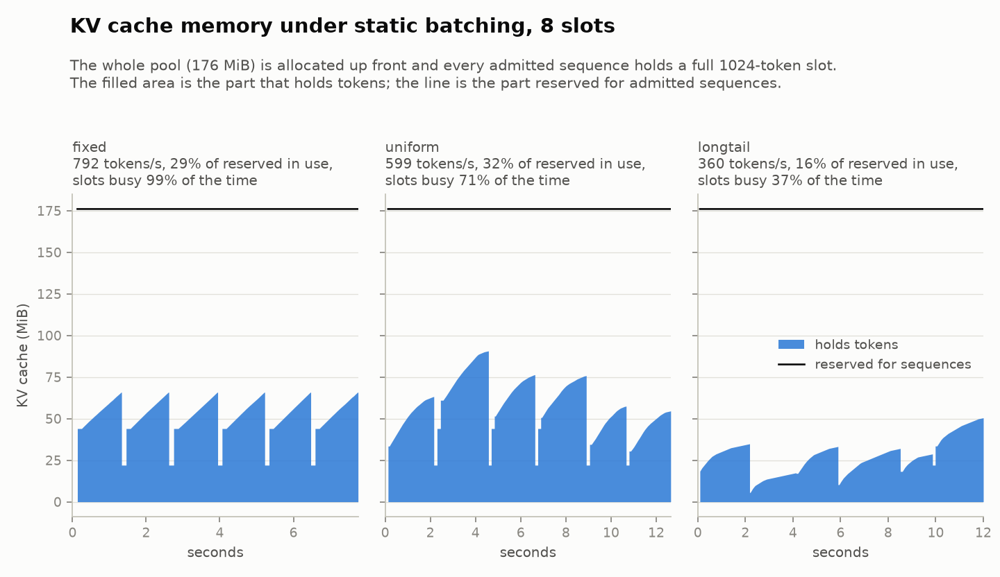
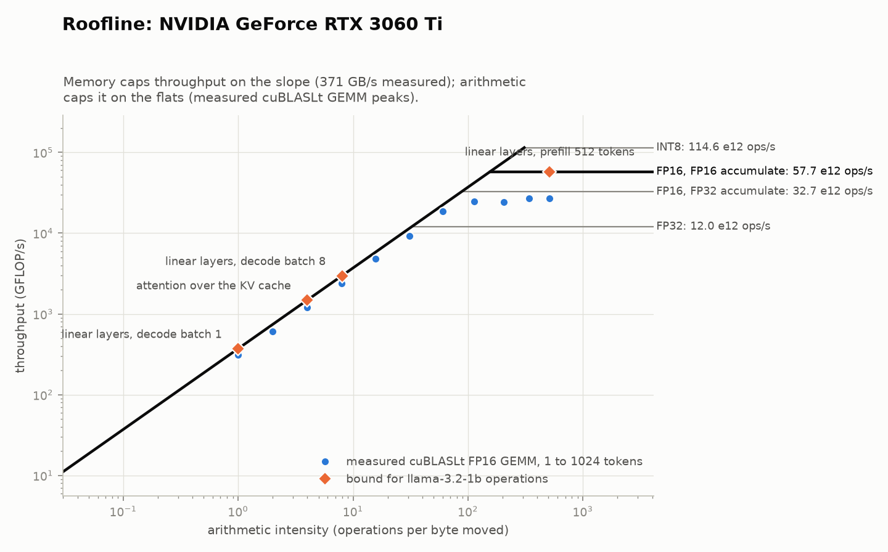

# kvbound

A from-scratch LLM inference engine in C++ and CUDA. It implements two KV-cache designs for the same engine, a static
preallocated one (how phone NPU runtimes work) and a paged one with continuous batching (how GPU serving systems
work), then quantizes and profiles both against the roofline of an RTX 3060 Ti (Ampere) and an RTX 4070 Ti (Ada).

**Status:** Phases 0 to 3 are done on the RTX 3060 Ti: reference model, golden tensors, hardware ceilings, the
analytical performance model, an FP16 engine that generates the same tokens as the reference model, and the static
memory design (preallocated KV slots, static batching, planned activation arena), measured on TinyLlama 1.1B and
Llama 3.2 1B. The paged KV cache is next. The RTX 4070 Ti runs are pending.

## Where things stand (RTX 3060 Ti, TinyLlama 1.1B, FP16)

| Quantity | Value | Source |
| --- | --- | --- |
| Memory bandwidth beyond cache, best 2 ms burst | about 415 GB/s (93% of the 448 GB/s spec) | `kvb-bandwidth_sweep` |
| Memory bandwidth beyond cache, sustained 0.1 s | about 367 GB/s; other desktop programs take turns on the GPU | `kvb-bandwidth_sweep` |
| Dependent-load latency, L1 / L2 / DRAM | about 21 / 135 / 312 ns | `kvb-pointer_chase` |
| GEMM peak, FP16 with FP16 / FP32 accumulate; INT8 | about 58 / 33 TFLOPS; 115 TOPS | `kvb-gemm_peak` (cuBLASLt) |
| Decode ceiling, batch 1 | about 200 tokens/s (weights 2.07 GB read once per token) | `python -m kvbound.perfmodel` |
| **kvbound decode, batch 1** | **144 tokens/s, 72% of the ceiling** (6.9 ms per token; 128 tokens/s without CUDA graphs) | `python -m kvbound.bench` |
| kvbound time to first token | 15 ms for a 128-token prompt, 201 ms for 1,024 tokens | `python -m kvbound.bench` |
| **kvbound static batching, 8 slots** | 792 tokens/s on equal-length requests, 360 tokens/s on long-tailed lengths (133 to 138 one at a time) | `python -m kvbound.serve` |
| Hugging Face Transformers decode, batch 1 | 17 to 33 tokens/s, depending on where the unlocked GPU clock settles | `python -m kvbound.baselines.hf` |

Greedy output matches the reference model token for token on every golden prompt, and every intermediate activation
stays within the FP16 limits in the golden manifest (`make test-real`).

Where a decode step's GPU time goes (Nsight Systems, `results/profiles/`): 90% in cuBLAS streaming the weights, 3% in
attention, 7% in the small kernels (norms, RoPE, residual adds). Launching the step's 357 kernels one by one costs about
1.5 ms of CPU time; replaying them from a CUDA graph costs 0.13 ms.

### What the static memory design costs

The static design preallocates the whole KV cache (8 slots of 1,024 tokens, 176 MiB) and gives every admitted sequence
a full slot until its batch ends.

| Workload (48 requests) | Tokens/s | Reserved KV memory holding tokens | Slots busy |
| --- | --- | --- | --- |
| `fixed`: 256-token prompts, 128-token outputs | 792 | 29% | 99% |
| `uniform`: prompts 32 to 512, outputs 16 to 256 | 599 | 32% | 71% |
| `longtail`: lognormal, median prompt 64 and output 48 | 360 | 16% | 37% |



Two more results from this phase:

- **KV layout.** Three orderings of the cache's dimensions were benchmarked with the engine's own kernels. Between
  the two layouts that keep a key's dimensions adjacent, which dimension is outermost changes attention time by 2% at
  batch 1 and 11% at batch 8. What matters more is how many memory requests a warp issues: reading each 128-byte key
  as eight 16-byte loads instead of 64 two-byte loads is 2.9 times faster (3.4 at batch 8), and only those two layouts
  allow it. Figure: `reports/rtx3060ti/kv_layout.png`. Hardware counters (Nsight Compute, `make counters`) match the
  counts derived from the code: for one layer at batch 1 with 4,096 cached tokens, the 2-byte kernel asks the L1 cache
  for 8.9 million sectors and the 16-byte kernel for 1.6 million, while both read the same 4.2 MB from DRAM, the
  layer's keys and values exactly once. Attention moves roughly 17 to 50 GB/s, far below the memory bandwidth, so the wide
  loads help by cutting the traffic to the L1 cache, not the traffic to DRAM.
- **Activation memory.** The forward pass has 225 intermediate tensors. Side by side they would need 1,039 MiB for
  1,024-token steps; placed by lifetime in one arena they share 30 MiB, which is also the lower bound. Figure:
  `reports/rtx3060ti/arena.png`.

Known gaps: prefill attention is still the simple per-query kernel (201 ms for 1,024 tokens against a 36 ms bound), and
cuBLAS is slower per token at batch 8 than at batch 1.

### The same engine on Llama 3.2 1B

Llama 3.2 1B (16 layers, 8 KV heads, tied embeddings, Llama 3 RoPE scaling) runs on the same code with no changes.
Greedy output matches the reference token for token on every golden prompt, and the worst intermediate activation is at
18% of its FP16 limit, as on TinyLlama.

| Quantity (RTX 3060 Ti, FP16) | Llama 3.2 1B | TinyLlama 1.1B |
| --- | --- | --- |
| Weights read per token | 2.47 GB | 2.07 GB |
| Decode ceiling, batch 1 | 168 tokens/s | 200 tokens/s |
| kvbound decode, batch 1 | 144 tokens/s, 86% of the ceiling | 144 tokens/s, 72% |
| kvbound decode without CUDA graphs | 136 tokens/s | 128 tokens/s |
| Time to first token, 128 / 1,024 prompt tokens | 13 ms / 147 ms | 15 ms / 201 ms |
| Static batching, 8 slots: `fixed` / `uniform` / `longtail` | 841 / 621 / 371 tokens/s | 792 / 599 / 360 tokens/s |
| Hugging Face Transformers decode, batch 1 | 47 tokens/s | 17 to 33 tokens/s |

Both models take 6.9 ms per token although Llama 3.2 reads 19% more weight bytes. It has 16 layers instead of 22, so a
decode step is about 278 kernels instead of 357, and less of the step goes to work that is not reading weights.

These runs come from Windows (WDDM), where GPU clocks cannot be locked, so every record is tagged `os=windows`, and
`clock_varied` when the clock moved during the run. Numbers meant for publication come from native Ubuntu with locked
clocks. Exact values are in `results/raw/` and the figures in `reports/`.



## Layout

| Path | What lives there |
| --- | --- |
| `engine/` | the C++ side. `kvbound` (CPU only): safetensors and JSON loaders, the op program, the activation memory planner, the scheduler, the sampler, cache bookkeeping. `kvbound_cuda`: kernels, device weights, KV pool, the engine |
| `engine/kernels/` | CUDA kernels: embedding, RMSNorm, RoPE, SwiGLU gate, residual add, attention over the KV cache, argmax; cuBLAS for matrix products |
| `apps/` | `kvb-bench` runs a trace of requests through the scheduler and prints raw timings; `kvb-kv_layout` times attention on each KV layout |
| `bindings/` | `_kvb`, the engine and each kernel as a Python extension, for tests |
| `microbench/` | standalone CUDA binaries that measure bandwidth, latency and GEMM peaks |
| `python/kvbound/ref/` | from-scratch PyTorch reference model (RMSNorm, RoPE, grouped-query attention, SwiGLU) |
| `python/kvbound/` | golden tensors, tolerance metrics, result records, fingerprint, baselines, perf model, bench and profile wrappers, plots |
| `fixtures/tiny-llama/` | committed 2-layer random model with goldens and thresholds; what CI tests against |
| `tests/cpp/` | GoogleTest, CPU only: parser, loader, fixture contract, op program, memory plan, scheduler, sampler, allocator |
| `tests/py/` | pytest: reference vs Hugging Face; under the `gpu` marker, each kernel vs torch and the engine vs the goldens |
| `configs/` | model, device and workload descriptions |
| `results/raw/<device>/` | one JSON record per benchmark run, written only by `kvbound.record` |
| `results/profiles/` | Nsight Systems summaries (CSV) of decode runs; Nsight Compute counters of the attention kernel |
| `reports/<device>/` | figures generated from the records |

## Build and test

```sh
make setup                 # TORCH=cu128 on GPU machines, TORCH=cpu elsewhere
make test                  # cpu preset: C++ tests and the fixture-based Python tests (what CI runs)
make test-gpu              # builds the cuda preset; every kernel vs torch, the engine vs the fixture goldens
make sanitize              # the engine under compute-sanitizer: memcheck, racecheck, initcheck
make help                  # every target
```

Requires CMake 3.27+, Ninja, a C++20 compiler, CUDA 12.x for the `cuda` presets, and [uv](https://docs.astral.sh/uv/).
On Windows, `make` needs Git Bash on `PATH` and finds MSVC through `scripts/vsenv.cmd`.

## Reproduce the measurements on a GPU machine

```sh
make doctor                          # GPU, toolchain, profilers, clock state
make fetch MODEL=tinyllama-1.1b      # pinned checkpoint into data/models/
make golden MODEL=tinyllama-1.1b     # golden tensors into data/golden/ (manifest is committed)
make test-real                       # reference vs Hugging Face, engine vs reference, on the real checkpoint
make bench-hf MODEL=tinyllama-1.1b   # Hugging Face baseline records
make microbench                      # hardware ceilings and the KV layout benchmark; builds the cuda preset first
make bench MODEL=tinyllama-1.1b      # kvbound engine records, one request at a time
make serve MODEL=tinyllama-1.1b      # static batching on the three workloads
make profile MODEL=tinyllama-1.1b    # Nsight Systems decode profiles
make counters                        # Nsight Compute counters of the attention kernel (needs GPU counter access)
make report MODEL=tinyllama-1.1b DEVICE=rtx3060ti   # figures into reports/
make predict MODEL=llama-3.2-1b DEVICE=rtx3060ti
```

Benchmarks refuse to run on a dirty tree unless given `--allow-dirty`, so every record maps to a commit.
`llama-3.2-1b` is gated: accept its license on Hugging Face and run `hf auth login` before `make fetch`.
