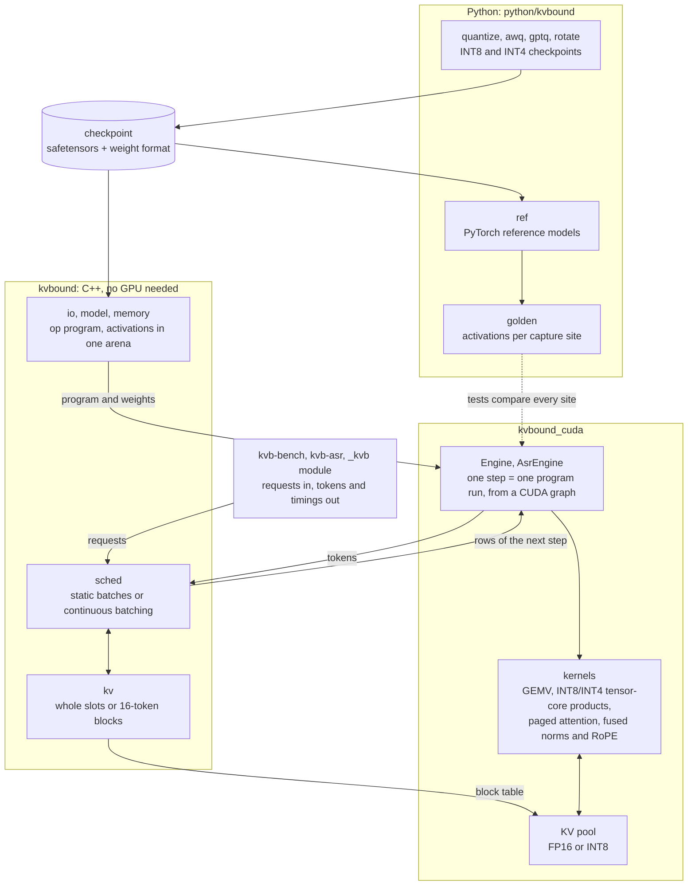
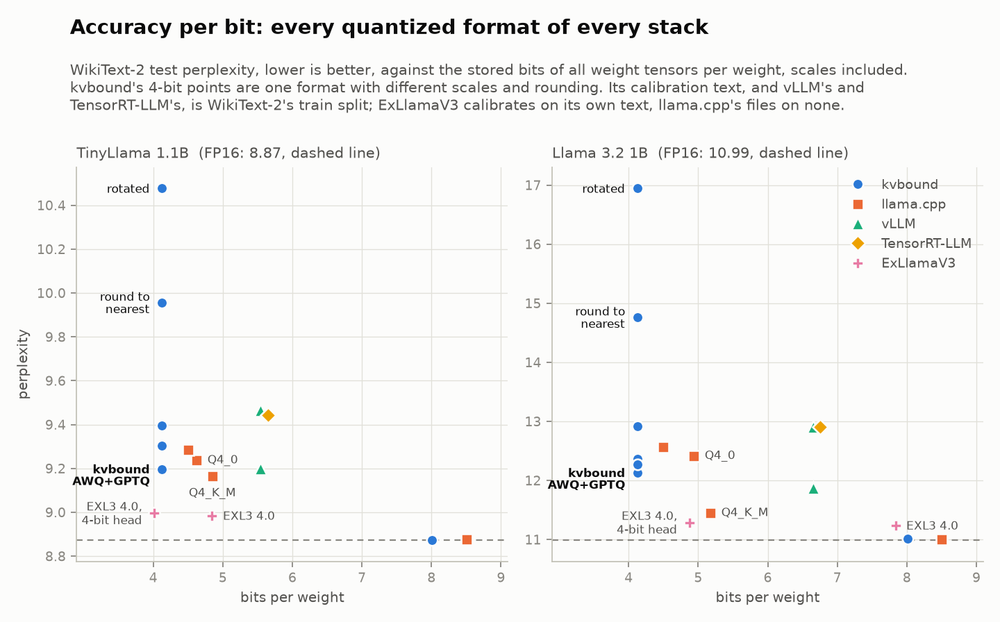

# kvbound

When a 1B-parameter language model generates text on a consumer GPU, what bounds its speed, and how close can an
engine get to that bound? kvbound is an LLM inference engine written from scratch in C++ and CUDA to answer that
with measurements. It asks four questions of TinyLlama 1.1B and Llama 3.2 1B on an RTX 3060 Ti (Ampere) and an
RTX 4070 (Ada):

1. **Roofline.** How close does decoding come to the ceiling set by memory bandwidth, at FP16, INT8 and INT4?
2. **KV memory.** What does a static, preallocated KV cache (as phone NPU runtimes use) cost against a paged one
   with continuous batching (as GPU serving systems use), in the same bytes and on the same requests?
3. **Quantization.** What do fewer bits cost in accuracy and buy in speed and concurrency, and how much of the loss
   do activation-aware scales (AWQ) and error-compensating rounding (GPTQ) recover?
4. **Production stacks.** Where does a hand-written engine stand against llama.cpp, vLLM, TensorRT-LLM and
   ExLlamaV3 on the same card, the same token ids and the same KV memory?

The engine also runs an encoder-decoder speech model, Whisper, measured against Hugging Face and faster-whisper.

## Key results

- **Decode reaches 89 to 96% of the bandwidth ceiling in FP16** on both cards and both models, and 66 to 85% at
  INT4, where the fixed per-step overhead weighs more against a smaller weight read.
- **Paging the same 176 MiB KV pool runs 1.9 to 3.3 times the tokens per second of static slots** and holds tokens
  in 89 to 92% of the reserved memory instead of 15 to 33%.
- **INT4 with AWQ scales and GPTQ rounding closes 70% of the perplexity gap to FP16** on both models. INT8 weights
  cost nothing measurable; an INT8 KV cache raises the sequences that fit from 30 to 58.
- **Against production stacks on one request, kvbound decodes 8 to 20% faster than llama.cpp, vLLM and TensorRT-LLM
  in FP16 and 1.3 to 2.1 times faster than all four at 4 bits.** It is level with vLLM under load, behind llama.cpp
  on a long prompt, and behind ExLlamaV3 in accuracy per bit.
- **Whisper on the same engine makes the same word errors as Hugging Face on each of 1,000 recitation clips**, and
  runs 12.1 times faster than it and 3.5 times faster than faster-whisper, greedy.

## Method



- **Engine.** A checkpoint becomes a flat program of ops whose intermediate tensors share one arena planned by
  lifetime. Each step the scheduler picks the rows to run (prompt tokens of new requests, one token of every running
  one) and the engine runs the program over them. The kernels are kvbound's own: an FP16 GEMV for decode, W8A16 and
  W4A16 tensor-core products that expand packed weights in registers, flash attention over a paged block table, and
  fused norm, RoPE and cache-write kernels. cuBLAS handles wide FP16 products.
- **Two memory designs, one engine.** The static and paged designs differ only in the scheduler's policy and how the
  KV pool is cut: whole 1,024-token slots, or 16-token blocks found through a block table.
- **Correctness.** From-scratch PyTorch reference models define what correct means. The engine must stay within
  FP16 tolerances of their activations at every capture site and generate the same greedy tokens, at every precision
  and after every optimization.
- **Measurement.** Every number is a JSON record in [`results/raw/`](results/raw/) tied to a clean commit and a
  device fingerprint, and figures are rendered from those records. Decode speed is read against a roofline built
  from measured bandwidth and GEMM peaks. Workloads are seeded traces: `fixed` (256-token prompts, 128-token
  outputs), `uniform`, and `longtail` (lognormal lengths, optionally Poisson arrivals).

[`docs/methodology.md`](docs/methodology.md) covers the hardware ceilings, the correctness contract, the workloads
and metrics, and the measurement protocol.

## Results

All figures and tables are from the RTX 3060 Ti unless they say otherwise.

### Decode against the roofline

A decode step multiplies one vector by every weight matrix, so it cannot finish before the weights cross the memory
bus once. That sets the ceiling: 200 tokens/s for TinyLlama in FP16 on the RTX 3060 Ti (2.07 GB at 415 GB/s).

| Decode, one request, tokens/s (share of ceiling) | RTX 3060 Ti | RTX 4070 |
| --- | --- | --- |
| TinyLlama 1.1B, FP16 / INT8 / INT4 weights | 177 / 312 / 507 (89% / 78% / 66%) | 212 / 391 / 673 (92% / 86% / 76%) |
| Llama 3.2 1B, FP16 / INT8 / INT4 weights | 154 / 281 / 475 (92% / 84% / 74%) | 183 / 348 / 624 (96% / 91% / 85%) |
| Time to first token, 1,024-token prompt, TinyLlama / Llama 3.2 | 73.3 / 70.6 ms | 38.6 / 39.6 ms |
| Hugging Face Transformers, TinyLlama FP16 decode | 17 to 33 | |

- **Decode follows the bytes.** A step is the weight read plus a near-constant 0.5 to 0.7 ms of everything else on
  the RTX 3060 Ti. The weight floor shrinks from 5.0 to 1.3 ms between FP16 and INT4, the rest does not, so the share
  of the ceiling falls with the bits.
- **Six kernel optimizations** (a fused 9-op layer, a custom GEMV, tensor-core quantized products, tensor-core
  prefill attention and two smaller ones) each run as an ablation. Together they take the 1,024-token prompt from
  201.6 to 73.3 ms and make quantized weights faster than FP16 under load instead of slower.
- **The cards differ by more than bandwidth.** The RTX 4070 has 1.14 times the bandwidth but decodes 1.19 to 1.33
  times faster: the part of its step that is not the weight read is about half as long, for reasons not yet
  established. Its 1.81 times the tensor-core throughput sets the prompt and most of serving.

Details: [`docs/kernel-optimization.md`](docs/kernel-optimization.md).

### Static against paged KV memory


| 48 requests, 176 MiB KV pool | Static, 8 slots | Continuous, 8 slots | Continuous, 16-token blocks |
| --- | --- | --- | --- |
| `fixed`, tokens/s | 955 | 966 | 1,776 |
| `longtail`, tokens/s | 451 | 947 | 1,469 |
| `longtail`, median time to first token | 4.15 s | 1.25 s | 0.18 s |
| Most sequences in one step | 8 | 8 | 30 to 48 |

- **The scheduler and the paging buy different things.** Continuous batching over the same whole slots recovers
  ragged workloads (`longtail` 451 to 947 tokens/s) but not equal ones. Only blocks raise the sequences that fit.
- **Paging costs latency per token and some recomputation.** Wider steps raise the median time per output token from
  7.5 to 13.0 ms on `fixed`, and a full pool preempts and recomputes. The block lookup needs a power-of-two block
  size: against a contiguous cache, a division makes attention up to 1.84 times slower, a shift and mask 1.07 to
  1.12 times.
- **Under arrivals the gap is the queue.** At 16 `longtail` requests per second, the median first token takes 3.3 s
  with static batching and 15 ms with paging.

Details, including a production static design on a Snapdragon NPU:
[`docs/static-vs-paged-memory.md`](docs/static-vs-paged-memory.md).

### Quantization



| WikiText-2 perplexity | TinyLlama 1.1B | Llama 3.2 1B |
| --- | --- | --- |
| FP16 | 8.87 | 10.99 |
| INT8 per channel | 8.87 | 11.01 |
| INT4 groups of 128, round to nearest | 9.96 | 14.76 |
| INT4, AWQ scales and clip | 9.40 | 12.91 |
| INT4, GPTQ rounding | 9.31 | 12.37 |
| INT4, AWQ scales and GPTQ rounding | 9.20 | 12.13 |

- **AWQ and GPTQ are complementary.** AWQ recovers about half of the gap between INT4 and FP16, GPTQ about 60%, and
  both together 70%. GPTQ needs columns ordered by activation energy: on Llama 3.2 one input channel carries 99.9%
  of a matrix's energy, and input order alone takes the model to perplexity 178.
- **Rotating the residual stream (QuaRot) does not help this format**: worse with rounding, within 0.1 with GPTQ.
- **An INT8 KV cache buys concurrency, not decode speed.** The same pool holds 58 sequences instead of 30, for 24%
  more tokens/s under load with FP16 weights.

Calibration uses the WikiText-2 train split, so it is in-domain for this metric. Details:
[`docs/quantization.md`](docs/quantization.md).

### Against production stacks


| RTX 3060 Ti | kvbound | llama.cpp | vLLM | TensorRT-LLM | ExLlamaV3 |
| --- | --- | --- | --- | --- | --- |
| TinyLlama, FP16 decode, one request, tokens/s | 180 | 160 | 150 | 153 | 62 |
| TinyLlama, fastest 4-bit decode, tokens/s | 512 | 391 | 331 | 291 | 245 |
| TinyLlama, first token of a 1,024-token prompt, FP16, ms | 72.6 | 69.9 | 86.1 | 86.2 | 95.0 |
| TinyLlama, `longtail` at 16 requests/s, FP16, tokens/s | 942 | 877 | 943 | 932 | not measured |
| TinyLlama, 96 `fixed` requests at once, FP16, tokens/s | 1,819 | 1,340 | 1,834 | 1,735 | not measured |
| Llama 3.2, 96 `fixed` requests at once, FP16, tokens/s | 1,917 | 1,026 | 1,809 | 1,650 | not measured |
| TinyLlama, best perplexity under 5 bits per weight (FP16: 8.87) | 9.20 at 4.13 | 9.16 at 4.85 | none under 5 | none under 5 | 8.99 at 4.85, 9.00 at 4.02 |

- **Ahead on one request.** Nsight profiles show llama.cpp's step about 0.7 ms longer: more and smaller products, a
  4-bit format with more bytes per weight, activation quantization before each product, and twenty stream
  synchronizations per step against one. vLLM's and TensorRT-LLM's 4-bit files keep the vocabulary matrix in FP16.
- **Level with vLLM under load**: within 1% on TinyLlama, 6% ahead on Llama 3.2. Both page the KV
  cache in 16-token blocks and run 30 sequences from the same bytes.
  llama.cpp is 26 to 46% behind with 96 requests, because its slots must be sized for 21 sequences and its server
  adds 4 to 8 ms per step.
- **Behind llama.cpp on a long prompt.** It accumulates wide FP16 products in FP16; kvbound's accuracy contract needs
  FP32, which this card's tensor cores run at 33 TFLOPS against 58.
- **Behind ExLlamaV3 in accuracy per bit.** Its trellis-coded format is 0.12 above FP16 perplexity at 4 bits, where
  kvbound's best is 0.32 above. kvbound has no format between 4 and 8 bits.

kvbound was measured again beside llama.cpp for this table, so its figures differ slightly from the sections above
(180 against 177 tokens/s in FP16 decode). Method, profiles and every table:
[`docs/production-comparison.md`](docs/production-comparison.md).

### Speech: Whisper on the same engine

The engine runs `whisper-base-ar-quran`, a Whisper base fine-tuned for Quran recitation: an encoder and a decoder
program over one weight table, a second cache for the encoder's output, and beam search whose beams share KV blocks
copy-on-write and rank candidates on the GPU. Measured on 1,000 test clips (3.79 hours, 36 reciters):

| One clip at a time | WER, greedy / beam 5 | Real-time factor, greedy / beam 5 |
| --- | --- | --- |
| kvbound, FP16 | 0.58% / 0.48% | 0.0047 / 0.0076 |
| kvbound, INT8 weights | 0.55% / 0.46% | 0.0040 / 0.0076 |
| Hugging Face Transformers, FP16 | 0.58% / 0.48% | 0.0568 / 0.0684 |
| faster-whisper GPU, `float16` | 0.72% / 0.60% | 0.0163 / 0.0209 |

kvbound and Hugging Face make the same number of word errors in the same number of decoder steps on every clip.
Details: [`docs/whisper.md`](docs/whisper.md).

## Limitations

- Measurements come from a shared Windows desktop where GPU clocks cannot be locked. Records carry `os=windows` and
  `clock_varied` tags, and decode is read by the median step.
- INT4 decode stops at 66% of its ceiling on the RTX 3060 Ti. The DRAM writes of the quantized tensor-core product on
  that card are 5.1 times its output, which is not explained.
- Prefill pays for FP32 accumulation. There is no weight format between 4 and 8 bits, no FP8 path, no prefix sharing,
  and steps that mix prefill and decode run without CUDA graphs.
- Whisper decodes one 30-second window without timestamps or word alignment.

## Reproduce

```sh
make setup                                          # TORCH=cu128 on GPU machines, TORCH=cpu elsewhere
make test                                           # CPU: C++ tests and fixture-based Python tests (CI)
make test-gpu                                       # every kernel vs torch, the engine vs the goldens
make reproduce MODEL=tinyllama-1.1b DEVICE=rtx3060ti  # fetch, quantize, test, benchmark, render figures
```

Requires CMake 3.27+, Ninja, a C++20 compiler, CUDA 12.x and [uv](https://docs.astral.sh/uv/). On Windows, `make`
needs Git Bash on `PATH`. `llama-3.2-1b` is gated on Hugging Face. Every target, including the production stacks:
[`docs/methodology.md`](docs/methodology.md).

## Repository layout

| Path | Contents |
| --- | --- |
| [`engine/`](engine/) | C++ core (loaders, op programs, memory planner, schedulers, KV bookkeeping, sampler, beam search) and the CUDA engine, kernels and KV pool |
| [`python/kvbound/`](python/kvbound/) | reference models, goldens, quantizers (AWQ, GPTQ, rotation), perf model, benchmark, serving and profiling drivers, evals, figures |
| [`python/kvbound/baselines/`](python/kvbound/baselines/) | Hugging Face, faster-whisper, llama.cpp, ExLlamaV3, vLLM, TensorRT-LLM and Qualcomm AI Hub, measured by the same record code |
| [`apps/`](apps/), [`bindings/`](bindings/), [`microbench/`](microbench/) | benchmark and ASR binaries, the `_kvb` Python module, hardware-ceiling microbenchmarks |
| [`tests/`](tests/), [`fixtures/`](fixtures/) | GoogleTest and pytest suites; 2-layer random Llama and Whisper fixtures with goldens, run in CI |
| [`results/`](results/), [`reports/`](reports/) | one JSON record per run, Nsight summaries, and the figures rendered from them |
| [`docs/`](docs/) | methodology, kernel optimization, KV memory designs, quantization, production comparison, Whisper |
