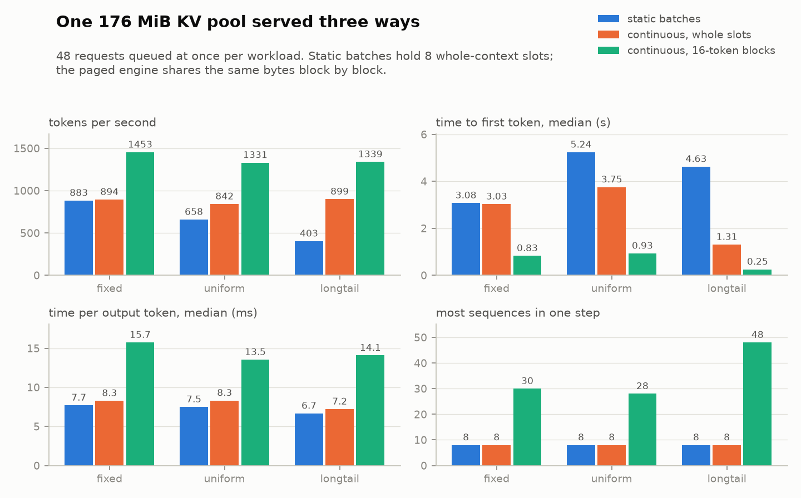
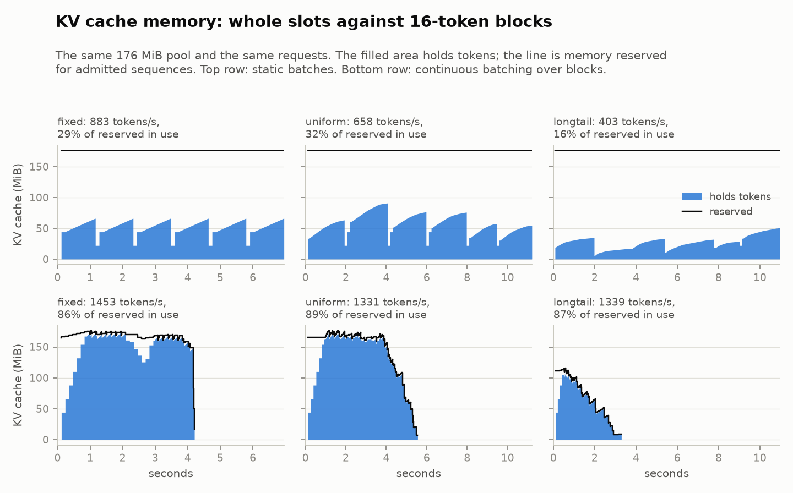
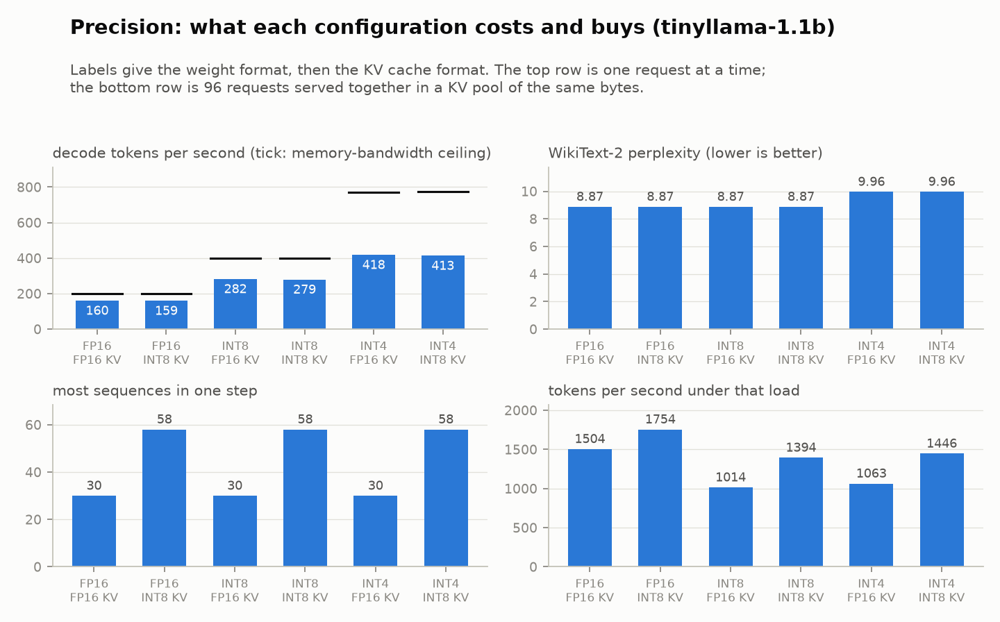

# kvbound

A from-scratch LLM inference engine in C++ and CUDA. It implements two KV-cache designs for the same engine, a static
preallocated one (how phone NPU runtimes work) and a paged one with continuous batching (how GPU serving systems
work), then quantizes and profiles both against the roofline of an RTX 3060 Ti (Ampere) and an RTX 4070 (Ada).

**Status:** Phases 0 to 6 are done on the RTX 3060 Ti and the RTX 4070, measured on TinyLlama 1.1B and Llama 3.2 1B:
reference model, golden tensors, hardware ceilings, the analytical performance model, an FP16 engine that generates the
same tokens as the reference model, the static memory design, the paged KV cache with continuous batching,
quantization (INT8 and INT4 weights, INT4 with activation-aware scales, an INT8 KV cache), and profiling and
optimization. Phase 6 is summarized next for both cards; its log, which also compares the two cards, is
[`docs/optimization-log.md`](docs/optimization-log.md). The sections after it describe the engine on the RTX 3060 Ti
as Phase 6 left it.

## Phase 6: profile and optimize

Six changes, each an engine option so that its before and after ran back to back at one commit (the Phase 5 paths are
`--no-fuse --f16-gemv-rows 0 --no-prefill-attention --expand-quantized`):

- **A fused decode step** (`fuse`): q|k|v and gate|up stacked into one product each at load time, residual adds folded
  into the norm after them, RoPE folded into the KV-cache write. 9 ops per layer instead of 16.
- **kvbound's own FP16 GEMV** (`f16_gemv_rows`, 4) instead of cuBLAS for decode-shaped steps. On the RTX 4070 it
  streams matrices at 436 to 477 GB/s of the measured 475; on the RTX 3060 Ti a decode step's matrices at 394 GB/s of
  the measured 415.
- **Streaming loads** in the quantized GEMV and a **register-resident RMSNorm** (no switch).
- **Quantized weights on tensor cores** (`quantized_gemm_rows`, 3; `expand_quantized` for the old path): a W8A16/W4A16
  `mma.sync` product that expands weights in registers and reads each matrix once at its packed size.
- **Prefill attention on tensor cores** (`prefill_attention`): flash attention over tiles of query rows, through the
  paged block table, FP16 or INT8 cache. 3.8 ms to 0.11 ms per layer at 1,024 tokens on the RTX 4070, 7.9 ms to
  0.23 ms on the RTX 3060 Ti.

| RTX 4070 | Phase 5 paths | Phase 6 |
| --- | --- | --- |
| TinyLlama decode, batch 1, FP16 / INT8 / INT4 | 202 / 370 / 610 tok/s | **212 / 391 / 673 tok/s** (92% / 86% / 76% of the ceiling) |
| Llama 3.2 decode, batch 1, FP16 / INT8 / INT4 | 178 / 336 / 585 tok/s | **183 / 348 / 624 tok/s** (96% / 91% / 85%) |
| TinyLlama / Llama 3.2 time to first token, 1,024-token prompt | 115.8 / 94.7 ms | **38.6 / 39.6 ms** |
| TinyLlama serving 96 requests, FP16 / INT8 / INT4 | 2,320 / 1,979 / 1,797 tok/s | **2,824 / 3,623 / 3,943 tok/s** |
| Llama 3.2 serving 96 requests, FP16 / INT8 / INT4 | 2,298 / 1,592 / 1,657 tok/s | **2,608 / 3,562 / 4,017 tok/s** |

| RTX 3060 Ti | Phase 5 paths | Phase 6 |
| --- | --- | --- |
| TinyLlama decode, batch 1, FP16 / INT8 / INT4 | 162 / 293 / 450 tok/s | **178 / 315 / 477 tok/s** (89% / 79% / 62% of the ceiling) |
| Llama 3.2 decode, batch 1, FP16 / INT8 / INT4 | 138 / 253 / 414 tok/s | **146 / 266 / 441 tok/s** (87% / 80% / 69%) |
| TinyLlama / Llama 3.2 time to first token, 1,024-token prompt | 205.4 / 167.0 ms | **76.4 / 72.4 ms** |
| TinyLlama serving 96 requests, FP16 / INT8 / INT4 | 1,463 / 979 / 1,013 tok/s | **1,740 / 2,163 / 2,219 tok/s** |
| Llama 3.2 serving 96 requests, FP16 / INT8 / INT4 | 1,554 / 937 / 1,002 tok/s | **1,827 / 2,217 / 2,342 tok/s** |

Quantized weights went from 15% to 31% slower than FP16 under load to 28% to 54% faster on the RTX 4070, and from 31%
to 40% slower to 21% to 28% faster on the RTX 3060 Ti. WikiText-2 perplexity is unchanged (8.8723 and 9.9563 for
TinyLlama FP16 and INT4, 10.9867 and 14.7617 for Llama 3.2; the RTX 3060 Ti reads the same to within 0.0001), and both
models still match the reference token for token. On the RTX 4070 the 1,024-token prompt is now 95% matrix products,
at the 59 TFLOPS FP16 peak with FP32 accumulation. On the RTX 3060 Ti that peak is 32.7 TFLOPS, which accounts for
60.7 of TinyLlama's 76.4 ms. Per-kernel Nsight Compute counters of one step (`make step-counters`) are in
`results/profiles/*-counters-*`.

Each table is one set of back-to-back runs, so a row's before and after are comparable, but the RTX 3060 Ti shares
its desktop and reads about 6% apart from run to run. Its Llama 3.2 pair ran about 5% slow on both sides, and one
TinyLlama INT4 run was disturbed; later runs of the same state read 154 to 155 / 284 / 472 tok/s for Llama 3.2 decode
and 504 tok/s for TinyLlama INT4, and those later runs are what the sections below quote.

**The two cards.** The RTX 4070 has 1.14 times the memory bandwidth of the RTX 3060 Ti (475 against 415 GB/s), 1.81
times its tensor-core peak for FP16 products with FP32 accumulation (59.1 against 32.7 TFLOPS), and a 36 MiB L2
against 3 MiB.

- **Memory bandwidth** sets FP16 decode, which is 1.18 to 1.26 times faster on the 4070: the FP16 GEMV reads at 95%
  and 97% of the two ceilings. The gap widens as the weights shrink, to between 1.32 and 1.41 times in INT4, because
  the rest of the step follows the SM clock (1.41 times higher on the 4070) and the INT4 kernel reads at only 66% of
  the 3060 Ti's bandwidth, against 85% on the 4070.
- **Tensor-core throughput** sets the 1,024-token prompt (1.98 and 1.83 times faster on the 4070) and most of serving
  (1.36 to 1.78 times).
- **L2 size** does not show in decode. In a 1,024-row step it shows as DRAM traffic: the 3060 Ti moves 8.7 times the
  bytes of the 4070 through the INT4 tensor-core products, and its norms, whose writes also cross DRAM there, take
  1.92 times as long in the profiles. No record isolates what the extra traffic costs the products.
- **FP8** tensor cores exist only on the 4070. No FP8 path is built, so they explain none of this.

The evidence for each line is in the [log](docs/optimization-log.md#the-two-cards-compared).

## Where things stand (RTX 3060 Ti, TinyLlama 1.1B)

| Quantity | Value | Source |
| --- | --- | --- |
| Memory bandwidth beyond cache, best 2 ms burst | about 415 GB/s (93% of the 448 GB/s spec) | `kvb-bandwidth_sweep` |
| Memory bandwidth beyond cache, sustained 0.1 s | about 367 GB/s; other desktop programs take turns on the GPU | `kvb-bandwidth_sweep` |
| Dependent-load latency, L1 / L2 / DRAM | about 21 / 135 / 312 ns | `kvb-pointer_chase` |
| GEMM peak, FP16 with FP16 / FP32 accumulate; INT8 | about 58 / 33 TFLOPS; 115 TOPS | `kvb-gemm_peak` (cuBLASLt) |
| Decode ceiling, batch 1, FP16 | about 200 tokens/s (weights 2.07 GB read once per token) | `python -m kvbound.perfmodel` |
| **kvbound decode, batch 1, FP16** | **168 tokens/s, 84% of the ceiling** (5.96 ms per token; 158 tokens/s without CUDA graphs) | `python -m kvbound.bench` (`make bench`) |
| kvbound time to first token | 11 ms for a 128-token prompt, 76 ms for 1,024 tokens | `python -m kvbound.bench` (`make bench`) |
| **kvbound decode, batch 1, INT8 / INT4 weights** | **315 / 504 tokens/s**, 79% / 65% of their ceilings | `python -m kvbound.bench --weights ...` (`make precision`) |
| kvbound static batching, 8 slots | 955 tokens/s on equal-length requests, 451 on long-tailed lengths (173 to 175 one at a time) | `python -m kvbound.serve` |
| **kvbound paged KV, continuous batching, same pool** | **1776 tokens/s on equal-length requests, 1469 on long-tailed lengths** | `python -m kvbound.serve --policy continuous` |
| Hugging Face Transformers decode, batch 1 | 17 to 33 tokens/s, depending on where the unlocked GPU clock settles | `python -m kvbound.baselines.hf` |

Greedy output matches the reference model token for token on every golden prompt, and every intermediate activation
stays within the FP16 limits in the golden manifest (`make test-real`).

Where an FP16 decode step's kernel time goes (Nsight Compute counters of one step, `results/profiles/*-counters-*`):
90% in kvbound's GEMV streaming the weights, 5% in attention, 5% in the small kernels (norms, RoPE with the cache
write, SwiGLU). The step is 204 kernel launches. Replayed from a CUDA graph it takes 5.96 ms; launched one by one,
6.32 ms.

These runs come from a shared Windows desktop with unlocked GPU clocks. The engine's decode, time-to-first-token and
serving numbers in this section and the ones below are from the Phase 6 records of this card (`make bench`,
`make precision`, `make serve` and `make serve-load` at one commit); the kernel microbenchmarks keep the records of
the phase that made them. Runs of one state differ by about 6%: FP16 decode reads 168 tokens/s in `make bench`, 170
in `make precision` and 178 in the Phase 6 pair above. Through the Phase 5 paths the same request reads 162 tokens/s.

### What the static memory design costs

The static design preallocates the whole KV cache (8 slots of 1,024 tokens, 176 MiB) and gives every admitted sequence
a full slot until its batch ends.

| Workload (48 requests) | Tokens/s | Reserved KV memory holding tokens | Slots busy |
| --- | --- | --- | --- |
| `fixed`: 256-token prompts, 128-token outputs | 955 | 30% | 99% |
| `uniform`: prompts 32 to 512, outputs 16 to 256 | 723 | 33% | 71% |
| `longtail`: lognormal, median prompt 64 and output 48 | 451 | 15% | 38% |


Two more results from this phase:

- **KV layout.** Three orderings of the cache's dimensions were benchmarked with the engine's own kernels. Between
  the two layouts that keep a key's dimensions adjacent, which dimension is outermost changes attention time by 2% at
  batch 1 and 11% at batch 8. What matters more is how many memory requests a warp issues: reading each 128-byte key
  as eight 16-byte loads instead of 64 two-byte loads is 2.9 times faster (3.4 at batch 8), and only those two layouts
  allow it. Figure: `reports/rtx3060ti/kv_layout.png`. Hardware counters (Nsight Compute, `make counters`) match the
  counts derived from the code: for one layer at batch 1 with 4,096 cached tokens, the 2-byte kernel asks the L1 cache
  for 8.9 million sectors and the 16-byte kernel for 1.6 million, while both read the same 4.2 MB from DRAM, the
  layer's keys and values exactly once. Attention moves roughly 17 to 50 GB/s, far below the memory bandwidth, so the wide
  loads help by cutting the traffic to the L1 cache, not the traffic to DRAM.
- **Activation memory.** The fused forward pass has 203 intermediate tensors. Side by side they would need 1,369 MiB
  for 1,024-token steps; placed by lifetime in one arena they share 37 MiB, which is also the lower bound. Figure:
  `reports/rtx3060ti/arena.png`.

### Paged KV cache and continuous batching

The paged design cuts the same pool into 16-token blocks. A request is admitted when the pool holds the blocks its
known tokens need plus one spare block for every running sequence that can still grow; a sequence gets another block
when it grows into one; and when the pool runs dry the most recently admitted sequence is preempted and recomputed
from its first token once readmitted. Requests join and leave between any two steps.

Same 176 MiB pool, same 48 requests queued at once. The middle setup runs the continuous scheduler over the 8 whole
slots, which separates what the scheduler buys from what paging buys.

| Workload | Setup | Tokens/s | Most sequences in a step | TTFT median | TPOT median | Reserved KV holding tokens |
| --- | --- | --- | --- | --- | --- | --- |
| `fixed` | static batches, 8 slots | 955 | 8 | 2.79 s | 7.5 ms | 30% |
| `fixed` | continuous, 8 whole slots | 966 | 8 | 2.75 s | 7.9 ms | 31% |
| `fixed` | continuous, 16-token blocks | 1776 | 30 | 0.51 s | 13.0 ms | 89% |
| `uniform` | static batches, 8 slots | 723 | 8 | 4.70 s | 7.3 ms | 33% |
| `uniform` | continuous, 8 whole slots | 874 | 8 | 3.75 s | 8.2 ms | 33% |
| `uniform` | continuous, 16-token blocks | 1593 | 28 | 0.51 s | 11.7 ms | 92% |
| `longtail` | static batches, 8 slots | 451 | 8 | 4.15 s | 6.5 ms | 15% |
| `longtail` | continuous, 8 whole slots | 947 | 8 | 1.25 s | 7.1 ms | 19% |
| `longtail` | continuous, 16-token blocks | 1469 | 48 | 0.18 s | 12.0 ms | 89% |





- **What it costs.** Steps carry more rows, so each token takes longer to arrive: the median time per output token on
  `fixed` rises from 7.5 to 13.0 ms. Admission does not know how long a response will get, so a full pool
  preempts: 9 preemptions and 2,769 tokens processed twice per pass on `fixed`, 5 and 1,684 on `uniform`, none on
  `longtail`, whose 48 requests all fit at once.
- **The block table.** Attention finds each cached position's block once per element it reads. Doing that with a
  division made attention 1.37 to 1.84 times slower than one block per sequence; a shift and a mask bring it to
  1.07 to 1.12 times, so a paged cache needs a power-of-two block size. Whether a sequence's blocks are in
  order or scattered over the pool makes no difference (`python -m kvbound.microbench kv_layout`).
- **Arrivals.** With `longtail` requests arriving as a Poisson process at 8 per second, static batching has a median
  time to first token of 1.9 s and the paged engine 13 ms; at 16 per second, 3.3 s and 15 ms
  (`make serve-load`, figure `reports/rtx3060ti/serving_load.png`).
- **CUDA graphs.** A graph replays one row count and continuous batching keeps changing it, so the engine keeps the 16
  most recently used. On `longtail` that is 41 captures and 55 ms per pass with 99% of steps replayed. In Phase 4,
  room for 64 graphs removed the captures and gave 1386 tokens/s against 1339; that comparison has not been run on
  the Phase 6 engine.

### Quantization

Weights are quantized by round-to-nearest with FP16 scales: INT8 per output channel, or INT4 in groups of 128 along
the input dimension, two values to a byte. The format is written into the checkpoint's safetensors metadata
(`python -m kvbound.quantize`) and read by the C++ loader and by the reference model, which dequantizes the same
file. The KV cache can hold INT8 with one FP16 scale per cached vector, quantized when written and scaled inside the
attention kernel. Perplexity is WikiText-2, the whole test split in 1,024-token windows, from the engine's logits.
The last two columns serve 96 `fixed` requests at once in a KV pool of the same bytes.

| TinyLlama 1.1B | Perplexity | Weights on device | KV bytes per token | Decode tokens/s | Of its ceiling | Sequences at once | Tokens/s under load |
| --- | --- | --- | --- | --- | --- | --- | --- |
| FP16 weights, FP16 KV | 8.87 | 2,098 MiB | 22,528 | 170 | 85% | 30 | 1746 |
| FP16 weights, INT8 KV | 8.87 | 2,098 MiB | 11,616 | 177 | 88% | 58 | 2168 |
| INT8 weights, FP16 KV | 8.87 | 1,050 MiB | 22,528 | 315 | 79% | 30 | 2270 |
| INT8 weights, INT8 KV | 8.87 | 1,050 MiB | 11,616 | 314 | 79% | 58 | 2370 |
| INT4 weights, FP16 KV | 9.96 | 541 MiB | 22,528 | 504 | 65% | 30 | 2356 |
| INT4 weights, INT8 KV | 9.96 | 541 MiB | 11,616 | 496 | 64% | 58 | 2440 |



Read against the roofline:

- **Decode speed follows the bytes.** A decode step is the weights crossing the memory bus once plus 0.7 to 0.9 ms
  of everything else. The floor set by the weights shrinks from 5.0 to 2.5 to 1.3 ms and the measured step from 5.9
  to 3.2 to 2.0 ms. The share of the ceiling falls because the rest does not shrink, and because on this card the
  INT4 kernel reads the weights at 273 GB/s of the measured 415.
- **INT8 weights are free in accuracy. INT4 is not, and activation-aware scales recover half of what it loses.**
  Round-to-nearest INT4 raises perplexity by 12% on TinyLlama and 34% on Llama 3.2. With AWQ scales it is 6% and
  18% above FP16; the numbers and the method follow this list.
- **An INT8 cache buys concurrency, not decode speed.** The same pool holds 992 blocks instead of 512, so 58
  sequences run at once instead of 30. Under load that is 24% more tokens/s with FP16 weights and 4% more with INT8
  or INT4 weights, and each token takes longer to arrive: with FP16 weights the median time per output token rises
  from 12.9 to 19.2 ms. Batch-1 decode does not change: 170 and 177 tokens/s with FP16 weights are 4.5% apart,
  inside the run-to-run spread. Attention over an INT8 cache is 10% faster at batch 8, but attention is a few
  percent of a step and was never bound by bandwidth.
- **Under load, quantized weights are now faster than FP16**: 2270 and 2356 tokens/s with INT8 and INT4 weights
  against 1746, 30% and 35% more. Steps wider than 3 rows multiply the packed weights on tensor cores and read each
  matrix once at its packed size. Phase 5 found the opposite, because wide steps expanded each matrix to FP16 for
  cuBLAS: through those paths the same workload still runs at 979 and 1,013 tokens/s against 1,463 in FP16. The four
  serve runs with quantized weights in the table are tagged `clock_varied`.
- The engine and the dequantizing reference agree on every capture site within the FP16 limits (`make test-gpu`); the
  reference model scores 8.87 on the FP16 checkpoint where the engine scores 8.87.

**INT4 with activation-aware scales (AWQ).** Rounding treats every weight alike, but a weight's error reaches the
output multiplied by the activation it meets. AWQ (Lin et al., 2023) rescales the input channels of a matrix before
rounding it, so that channels with large activations get a finer step, and divides the activations by the same
scales (`python -m kvbound.quantize <model> --scheme int4_g --awq`, `python/kvbound/awq.py`):

- **Scales.** Each layer has three: one for the inputs of q, k and v, folded into the weight of the RMSNorm before
  them; one for the inputs of gate and up, folded into the RMSNorm before those; one for the input of down_proj,
  folded into the rows of up_proj. A scale is the mean activation magnitude of its channel raised to a power, and
  the power is the one of 20 that least changes the output of the attention or MLP it feeds. o_proj, the embedding
  and the vocabulary matrix are not scaled.
- **Clipping.** Each group of 128 weights in v, o_proj, gate, up and down_proj then gets the clip range, of 10
  tried, that changes that matrix's output least on a sample of the calibration activations.
- **Calibration.** 128 windows of 512 tokens from the WikiText-2 train split, at the same pinned dataset revision as
  the test split that perplexity is measured on. Calibration is therefore in-domain for this metric, and text from
  elsewhere may gain less.
- **Format.** The scales are folded into the weights before quantization, so the result is an ordinary `int4_g`
  checkpoint, and neither the engine nor its kernels change.

| WikiText-2 perplexity, FP16 KV (RTX 3060 Ti) | TinyLlama 1.1B | Llama 3.2 1B |
| --- | --- | --- |
| FP16 weights | 8.87 | 10.99 |
| INT8 weights | 8.87 | 11.01 |
| INT4, round to nearest (`int4_g`) | 9.96 | 14.76 |
| INT4, clip chosen by weight error (`int4_g.mse`) | 10.84 | 14.63 |
| INT4, AWQ scales without the clip search (`int4_g.awq-noclip`) | 9.60 | 13.47 |
| INT4, AWQ scales and clip (`int4_g.awq`) | 9.40 | 12.91 |

AWQ recovers 52% of the gap between INT4 and FP16 on TinyLlama and 49% on Llama 3.2; the scales alone recover 33%
and 34%, and the clip search the rest. Clipping by weight error alone, the earlier attempt, makes TinyLlama worse
and barely moves Llama 3.2: the clip has to be chosen by its effect on the output. INT4 with AWQ still costs 6% in
perplexity over FP16 on TinyLlama and 18% on Llama 3.2. Its decode and serving speed have not been recorded: the
speed columns of the precision table are plain INT4.

Known gaps after Phase 6: INT4 decode on this card stops at 62% to 65% of its ceiling; INT4 with AWQ scales still
costs the perplexity above and has no speed record; FP16 steps of 5 to 64 rows still go through cuBLAS; decode
attention still runs one block per head at long context; steps that mix prefill and decode run without CUDA graphs;
prefix sharing is not built, and the FP8 KV cache is not built. The largest Phase 5 gap is closed: a 1,024-token
prompt takes 76 ms where the Phase 5 paths take 205 ms.

### The same engine on Llama 3.2 1B

Llama 3.2 1B (16 layers, 8 KV heads, tied embeddings, Llama 3 RoPE scaling) runs on the same code with no changes.
Greedy output matches the reference token for token on every golden prompt, and the worst intermediate activation is at
18% of its FP16 limit, as on TinyLlama.

| Quantity (RTX 3060 Ti) | Llama 3.2 1B | TinyLlama 1.1B |
| --- | --- | --- |
| Weights read per token, FP16 | 2.47 GB | 2.07 GB |
| Decode ceiling, batch 1, FP16 | 168 tokens/s | 200 tokens/s |
| kvbound decode, batch 1, FP16 (`make bench`) | 154 tokens/s, 92% of the ceiling | 168 tokens/s, 84% |
| kvbound decode without CUDA graphs | 150 tokens/s | 158 tokens/s |
| Time to first token, 128 / 1,024 prompt tokens | 11 ms / 70 ms | 11 ms / 76 ms |
| Static batching, 8 slots: `fixed` / `uniform` / `longtail` | 883 / 658 / 397 tokens/s | 955 / 723 / 451 tokens/s |
| Paged, continuous batching, same pool (256 / 176 MiB) | 1877 / 1628 / 1397 tokens/s | 1776 / 1593 / 1469 tokens/s |
| Most sequences in a step, paged | 30 / 28 / 48 | 30 / 28 / 48 |
| Perplexity, FP16 / INT8 / INT4 weights | 10.99 / 11.01 / 14.76 | 8.87 / 8.87 / 9.96 |
| Perplexity, INT4 weights with AWQ scales | 12.91 | 9.40 |
| Decode, batch 1, FP16 / INT8 / INT4 weights (`make precision`) | 155 / 284 / 472 tokens/s | 170 / 315 / 504 tokens/s |
| Sequences at once, FP16 / INT8 KV, 96 `fixed` requests | 30 / 58 | 30 / 58 |
| Hugging Face Transformers decode, batch 1 | 47 tokens/s | 17 to 33 tokens/s |

Llama 3.2 reads 19% more weight bytes per token than TinyLlama but has 16 layers instead of 22, so a decode step is
150 kernel launches instead of 204 and less of the step goes to work that is not reading weights: the step ends 0.5
to 0.6 ms above its floor at every weight precision, where TinyLlama's ends 0.7 to 0.9 ms above.

These runs come from Windows (WDDM), where GPU clocks cannot be locked, so every record is tagged `os=windows`, and
`clock_varied` when the clock moved during the run. Numbers meant for publication come from native Ubuntu with locked
clocks. Exact values are in `results/raw/` and the figures in `reports/`.


## Layout

| Path | What lives there |
| --- | --- |
| `engine/` | the C++ side. `kvbound` (CPU only): safetensors and JSON loaders, the weight format, the op program, the activation memory planner, the scheduler (static and continuous), the sampler, cache bookkeeping. `kvbound_cuda`: kernels, device weights, KV pool, the engine |
| `engine/kernels/` | CUDA kernels: embedding, RMSNorm (also fused with the residual add), RoPE (also fused with the cache write), SwiGLU gate, residual add, decode attention and tiled tensor-core prefill attention over an FP16 or INT8 KV cache, argmax, an FP16 GEMV, products and lookups on INT8 and INT4 weights in place and on tensor cores; cuBLAS for wide FP16 products |
| `apps/` | `kvb-bench` runs a trace of requests through the scheduler and prints raw timings; `kvb-kv_layout` times attention on each KV layout, on 16-token blocks and on an INT8 cache |
| `bindings/` | `_kvb`, the engine and each kernel as a Python extension, for tests and evals |
| `microbench/` | standalone CUDA binaries that measure bandwidth, latency and GEMM peaks |
| `python/kvbound/ref/` | from-scratch PyTorch reference models: Llama (RMSNorm, RoPE, grouped-query attention, SwiGLU), which loads quantized checkpoints by dequantizing them, and Whisper (conv stem, encoder, decoder with cross attention, greedy decoding) |
| `python/kvbound/` | golden tensors, tolerance metrics, result records, fingerprint, baselines, perf model, workloads, the quantizer and its AWQ scale search, bench, serve and profile wrappers, plots |
| `python/kvbound/evals/` | WikiText-2 perplexity, and per-site error against the goldens with sample text |
| `fixtures/tiny-llama/`, `fixtures/tiny-whisper/` | committed 2-layer random models with goldens and thresholds; what CI tests against |
| `tests/cpp/` | GoogleTest, CPU only: parser, loader, weight format, fixture contract, op program, memory plan, both scheduling policies, sampler, allocator |
| `tests/py/` | pytest: reference vs Hugging Face, the quantizer, the perplexity arithmetic; under the `gpu` marker, each kernel vs torch and the engine vs the goldens, FP16 and quantized |
| `configs/` | model, device and workload descriptions |
| `results/raw/<device>/` | one JSON record per benchmark or evaluation run, written only by `kvbound.record` |
| `results/profiles/` | Nsight Systems summaries (CSV) of decode runs; Nsight Compute counters of the attention kernel and of every kernel in one step |
| `docs/` | `optimization-log.md`: each Phase 6 change with its hypothesis, before and after, and profiler evidence, and the comparison of the two cards |
| `reports/<device>/` | figures generated from the records |

## Build and test

```sh
make setup                 # TORCH=cu128 on GPU machines, TORCH=cpu elsewhere
make test                  # cpu preset: C++ tests and the fixture-based Python tests (what CI runs)
make test-gpu              # builds the cuda preset; every kernel vs torch, the engine vs the fixture goldens
make sanitize              # the engine under compute-sanitizer: memcheck, racecheck, initcheck
make help                  # every target
```

Requires CMake 3.27+, Ninja, a C++20 compiler, CUDA 12.x for the `cuda` presets, and [uv](https://docs.astral.sh/uv/).
On Windows, `make` needs Git Bash on `PATH` and finds MSVC through `scripts/vsenv.cmd`.

## Reproduce the measurements on a GPU machine

```sh
make doctor                          # GPU, toolchain, profilers, clock state
make fetch MODEL=tinyllama-1.1b      # pinned checkpoint into data/models/
make golden MODEL=tinyllama-1.1b     # golden tensors into data/golden/ (the per-GPU manifest is committed)
make quantize MODEL=tinyllama-1.1b   # INT8, INT4 and INT4-with-AWQ copies of the checkpoint into data/models/
make test-real                       # reference vs Hugging Face, engine vs reference, on the real checkpoint
make bench-hf MODEL=tinyllama-1.1b   # Hugging Face baseline records
make microbench                      # hardware ceilings and the KV layout benchmark; builds the cuda preset first
make bench MODEL=tinyllama-1.1b      # kvbound engine records, one request at a time
make serve MODEL=tinyllama-1.1b      # the three workloads in one KV pool: static, continuous over slots, paged
make serve-load MODEL=tinyllama-1.1b # static against paged as requests arrive at 2 to 16 per second
make precision MODEL=tinyllama-1.1b  # each weight and KV precision: perplexity, per-layer error, decode, concurrency
make profile MODEL=tinyllama-1.1b    # Nsight Systems decode profiles
make counters                        # Nsight Compute counters of the attention kernel (needs GPU counter access)
make step-counters MODEL=tinyllama-1.1b WEIGHTS=int4_g   # Nsight Compute counters of one decode and one prefill step
make report MODEL=tinyllama-1.1b DEVICE=rtx3060ti   # figures into reports/
make predict MODEL=llama-3.2-1b DEVICE=rtx3060ti
```

Benchmarks refuse to run on a dirty tree unless given `--allow-dirty`, so every record maps to a commit.
`llama-3.2-1b` is gated: accept its license on Hugging Face and run `hf auth login` before `make fetch`.
