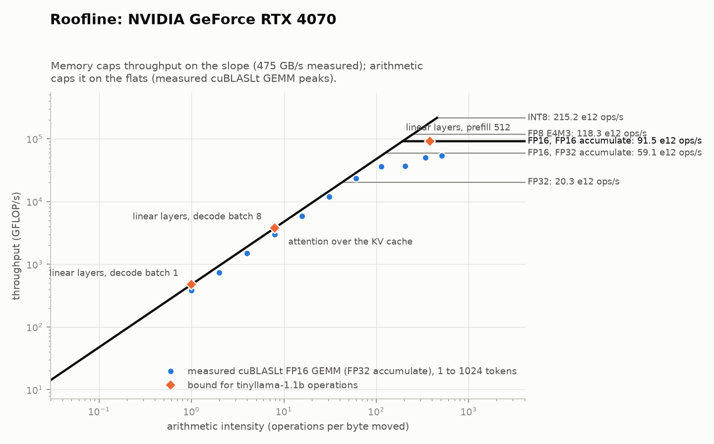
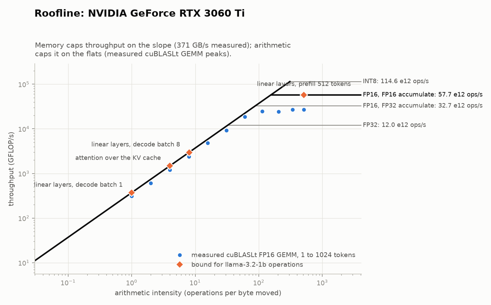

# Kernel optimization

A batch-1 decode step of a 1B-parameter model reads every weight once and does little arithmetic on each, so its
floor is the weights' size over the memory bandwidth. A prefill step over a long prompt does arithmetic in proportion
to its rows on every weight it reads, so its floor is the tensor cores' throughput. This document measures how close
kvbound's steps come to those floors on an RTX 3060 Ti and an RTX 4070, and evaluates six engine optimizations as
ablations: the same build and workload with the optimization on and off.

With all six enabled, batch-1 decode in FP16 runs at 89% to 96% of each card's memory ceiling, the 1,024-token prompt
is 2.3x to 3.0x faster than in the baseline configuration, and serving with quantized weights is 1.8x to 2.4x faster,
which makes INT8 and INT4 weights faster than FP16 under load instead of slower. Accuracy is unchanged.

## Data

The RTX 4070 (`rtx4070-d6f35005`) tables come from back-to-back pairs at `bdcdb3d`. The RTX 3060 Ti
(`rtx3060ti-fd7b40d5`) ran the pairs twice; its tables use the 2026-11-18 records at `4089b55`, taken with the desktop
quiet. In that set the mean and median step of each of the 22 decode records differ by at most 0.87%, the three passes
of each serving run are within 0.8%, and two serving runs (TinyLlama INT8 and INT4, optimized) are tagged
`clock_varied`, with the SM clock between 1,785 and 1,935 MHz. The 3060 Ti's profiles and perplexity come from its
2026-11-17 set at `c442759`, and its profile-to-record comparisons use that set's pairs. Profiles are
`results/profiles/20261117T1318*` and `20261117T1319*` (RTX 4070), `20261117T2123*` to `20261117T2125*` (RTX 3060 Ti).
Both cards run Windows (WDDM) with unlocked clocks; every record is tagged `os=windows`.

## Method

**Configurations.** The *baseline* is `--no-fuse --f16-gemv-rows 0 --no-prefill-attention --expand-quantized`, with
`--quantized-gemm-rows 16` when serving; the *optimized* configuration is the engine's defaults. Optimizations 3 and 4
have no switch, so the baseline includes them and they are measured by alternating builds. The paired tables switch
all options together and give their combined effect; the per-optimization measurements and the per-kernel counters tie
an effect to one optimization.

**Workloads.** Batch-1 decode with a 128-token prompt and 128 new tokens; time to first token (TTFT) for a 128-token
and a 1,024-token prompt; serving 96 equal-length requests (256-token prompts, 128 new tokens) in a 176 MiB paged pool
of 16-token blocks, up to 64 sequences. The decode ceiling, timing protocol and correctness tests are in
[methodology.md](methodology.md). Reproduce with `make bench`, `make serve`, `make precision` and `make step-counters`.

**Readings.** RTX 4070 decode is the mean step as recorded (`decode_tok_s`); mean and median agree within 0.5%. RTX
3060 Ti decode is the median step (`decode_step_p50_s`), which moves no cell by more than one unit except the INT4
optimized runs, which read 503 (TinyLlama) and 471 tok/s (Llama 3.2) by the mean. TTFT and serving have one reading.

**Counters.** `kvbound.step_counters` profiles one step under Nsight Compute, caches flushed before each replay. It
collects DRAM bytes, tensor-pipe activity, resident warps and registers per thread, but no L2 or local-memory counters,
and does not set `--clock-control`, so the SM clock during a profile is unknown. Replays lengthen small kernels, so a
profiled time is compared only with other times in the same profile.

## What bounds a step

Decode linear layers at batch 1 sit at one operation per byte, on the memory slope of both rooflines; prefill at 512
rows sits on the flat. The engine accumulates products in FP32, so the prefill bound that applies is the
FP16-with-FP32-accumulate peak (59.1 TFLOPS on the 4070, 32.7 on the 3060 Ti), not the FP16-accumulate one (91.5 and
57.7).

## Results

| RTX 4070 | Baseline | Optimized |
| --- | --- | --- |
| TinyLlama decode, batch 1, FP16 / INT8 / INT4 | 202 / 370 / 610 tok/s | **212 / 391 / 673 tok/s** (92% / 86% / 76% of the ceiling) |
| Llama 3.2 decode, batch 1, FP16 / INT8 / INT4 | 178 / 336 / 585 tok/s | **183 / 348 / 624 tok/s** (96% / 91% / 85%) |
| TinyLlama TTFT, 128-token prompt, FP16 / INT4 | 9.1 / 13.6 ms | **6.7 / 6.5 ms** |
| TinyLlama / Llama 3.2 TTFT, 1,024-token prompt | 115.8 / 94.7 ms | **38.6 / 39.6 ms** |
| TinyLlama serving 96 requests, FP16 / INT8 / INT4 | 2,320 / 1,979 / 1,797 tok/s | **2,824 / 3,623 / 3,943 tok/s** |
| Llama 3.2 serving 96 requests, FP16 / INT8 / INT4 | 2,298 / 1,592 / 1,657 tok/s | **2,608 / 3,562 / 4,017 tok/s** |

| RTX 3060 Ti | Baseline | Optimized |
| --- | --- | --- |
| TinyLlama decode, batch 1, FP16 / INT8 / INT4 | 162 / 291 / 450 tok/s | **177 / 312 / 507 tok/s** (89% / 78% / 66% of the ceiling) |
| Llama 3.2 decode, batch 1, FP16 / INT8 / INT4 | 145 / 270 / 437 tok/s | **154 / 281 / 475 tok/s** (92% / 84% / 74%) |
| TinyLlama TTFT, 128-token prompt, FP16 / INT4 | 14.3 / 20.4 ms | **10.6 / 11.3 ms** |
| TinyLlama / Llama 3.2 TTFT, 1,024-token prompt | 201.6 / 163.4 ms | **73.3 / 70.6 ms** |
| TinyLlama serving 96 requests, FP16 / INT8 / INT4 | 1,517 / 1,013 / 1,060 tok/s | **1,804 / 2,214 / 2,290 tok/s** |
| Llama 3.2 serving 96 requests, FP16 / INT8 / INT4 | 1,623 / 980 / 1,039 tok/s | **1,901 / 2,279 / 2,403 tok/s** |

- **Decode** gains +4.5% / +5.5% / +10% (TinyLlama FP16 / INT8 / INT4) and +3.1% / +3.6% / +6.7% (Llama 3.2) on the
  4070, and +9.3% / +7.3% / +12.9% and +6.3% / +4.2% / +8.7% on the 3060 Ti. The gain is largest with INT4 weights
  on every model and card, where the fixed per-step overhead the optimizations remove is the largest share of a step.
- **Serving.** In the baseline, quantized weights serve 15% to 31% slower than FP16 on the 4070 and 30% to 40% slower
  on the 3060 Ti; optimized, 28% to 54% and 20% to 27% faster. The median time per output token serving INT4 is 12.6
  against 5.7 ms (TinyLlama) and 13.7 against 5.6 ms (Llama 3.2) on the 4070, 21.3 against 9.7 ms and 21.9 against
  9.2 ms on the 3060 Ti.
- **Accuracy.** WikiText-2 perplexity in the optimized configuration is 8.8723 (TinyLlama FP16), 9.9563 (TinyLlama
  INT4), 10.9867 (Llama 3.2 FP16) and 14.7617 (Llama 3.2 INT4), the baseline's values; the 3060 Ti reads the same to
  within 0.0001. Both models match the reference token for token (`make test-real`).

## The six optimizations

Measured on the RTX 4070 with TinyLlama unless stated.

### 1. Fused decode step (`--no-fuse` disables)

**Hypothesis.** In the baseline about a millisecond of every decode step is small kernels and the gaps between them,
a fixed cost that is 46% of an INT4 step. Small projections are also inefficient: k and v are 1 MiB each and stream at
about 270 GB/s under cuBLAS.

**Change.** `build_llama_program(cfg, fuse=true)` emits 9 ops per layer instead of 16. q, k and v are stacked into one
matrix at load time, as are gate and up (every weight format stores rows contiguously, so stacking is concatenation,
also for INT8 and INT4 with their scales). Each residual add folds into the RMSNorm after it (`AddRmsNorm`); RoPE folds
into the KV-cache write (`RopeKvWrite`, which also quantizes an INT8 cache); SiLU-and-multiply reads the two halves of
the gate|up output. A step has 204 launches instead of 357. The capture sites are unchanged, so the goldens apply.

**Evidence.** In Nsight Systems the fused step's small kernels (`rope_kv_write`, `silu_mul`, the norms) take 1.3, 1.1
and 2.9 µs each, and replace 5 kernels of 1.1 to 2.8 µs per layer.

**Effect.** With the other options at baseline and CUDA graphs on, the decode step is 4.97 against 4.83 ms in FP16,
2.81 against 2.70 ms in INT8 and 1.79 against 1.66 ms in INT4 (off against on). Prefill gains more, since every
unfused op at 128 rows is a full pass over activations: TTFT for a 128-token FP16 prompt is 9.1 against 6.7 ms.

### 2. FP16 GEMV for decode (`--f16-gemv-rows 0` disables)

**Hypothesis.** cuBLAS's GEMV reaches 412 GB/s on a decode step, 87% of the 475 GB/s measured ceiling. A kernel built
only to stream the matrix should come within a few percent of it.

**Change.** `linear_f16` (`engine/kernels/gemv.cu`) uses one warp per output channel and 16-byte loads with a
streaming cache hint, accumulating in FP32. Steps of up to `f16_gemv_rows` rows (default 4) use it.

**Evidence.** Per matrix in a decode step (Nsight Systems): o_proj 436 GB/s, q|k|v 443, down 463, gate|up 472, and the
vocabulary projection 477, the measured ceiling. In Nsight Compute every decode product kernel shows 0% tensor use and
84 to 88% of warps resident: a memory stream, whose remaining gap is the smaller matrices.

**Effect.** With fusion on, the FP16 decode step is 4.83 ms with cuBLAS and 4.63 ms with `linear_f16`. By rows:

| Rows | 1 | 2 | 4 | 8 | 16 |
| --- | --- | --- | --- | --- | --- |
| cuBLAS (ms) | 4.75 | 5.07 | 5.09 | 5.19 | 5.51 |
| kvbound (ms) | 4.70 | 4.85 | 4.93 | 5.37 | 7.52 |

From 8 rows the per-row FP32 arithmetic costs more than the reads it shares, hence the default of 4. Four or eight
loads in flight per lane measure 0.8% and 1.6% slower than one (the extra registers cut resident warps, and at this
occupancy warps hide latency better than per-lane parallelism; the INT4 kernel is 15% slower with it), and dropping
the streaming hint 1% slower.

### 3. Streaming loads in the quantized GEMV (no switch)

Every warp of a block rereads the rows of x, so `linear_quantized` reads weights with `__ldcs`, which keeps them out of
L1 and leaves L1 to x. Alternating two builds, both with optimizations 1 and 4: INT4 decode step 1.531 against
1.461 ms (−4.6%), INT8 2.555 against 2.515 ms.

### 4. RMSNorm in registers (no switch)

A decode step normalizes one row per block, so the kernel's time is its chain of dependent memory accesses. A row of up
to 8,192 elements is loaded once as 16-byte chunks, kept in registers between the sum of squares and the scaling, and
written as 16-byte chunks, in place of two strided passes of 2-byte accesses. INT4 decode with fusion off (45 norms per
step) is 1.79 ms in the baseline build and 1.69 ms in a build with this change, which also carries the build state of
optimization 3's comparison, so the difference is not attributed to this change alone.

### 5. Quantized weights on tensor cores (`--expand-quantized` disables)

**Hypothesis.** The baseline expands every quantized matrix to FP16 in 32 MiB slices for cuBLAS, about 8 ms a step
under load, and the in-place GEMV turns arithmetic-bound beyond a few rows, since every row adds FP32 work per weight
on CUDA cores. A tensor-core product that reads the packed weights once removes both costs.

**Change.** `gemm_quantized` (`engine/kernels/quantized.cu`) is a W8A16/W4A16 product on `mma.sync.m16n8k16`. Packed
weights and x arrive by `cp.async` in 2 to 4 stages; each weight is expanded to FP16 in the registers the MMA reads, so
weights cross DRAM and shared memory at their packed size; the tile shape is picked by row count. Each dequantized
weight equals what `dequantize` writes (`__float2half(q * scale)`), checked bit for bit by a test. Steps wider than
`quantized_gemm_rows` (default 3) take it.

**Evidence.** In Nsight Compute at 32 rows the weights are read once per launch: 67.6 MB of DRAM reads for 65.5 MB of
INT8 weights. At small row counts INT4 is bound by instruction issue, not memory (170 to 400 GB/s), which is why the
in-place kernel wins at 1 and 2 rows.

**Effect.** On TinyLlama's gate|up (2048 × 11264), against expansion plus cuBLAS: INT8 53 against 193 µs at 17 rows,
82 against 245 µs at 64 rows, 863 against 949 µs at 1,024 rows (55 TFLOPS); INT4 37 against 196 µs at 17 rows. At 512
to 1,024 rows it reaches 53 to 57 TFLOPS, against 59 for FP16 cuBLAS with FP32 accumulation. Decode steps by rows:

| Rows | 1 | 2 | 3 | 4 | 8 | 16 |
| --- | --- | --- | --- | --- | --- | --- |
| INT4 in place (ms) | 1.48 | 1.82 | 2.39 | 3.04 | 5.52 | 10.78 |
| INT4 tensor cores (ms) | 2.27 | 2.42 | 2.39 | 2.44 | 2.57 | 2.88 |
| INT8 in place (ms) | 2.55 | 2.78 | 2.81 | 2.96 | 4.05 | 7.05 |
| INT8 tensor cores (ms) | 2.78 | 2.94 | 2.92 | 2.96 | 3.12 | 3.40 |

The two tie at 3 rows (INT4) and 4 rows (INT8), hence the default of 3. Serving 96 requests with INT4 weights runs at
1,797 against 3,943 tokens/s (TinyLlama) and 1,657 against 4,017 (Llama 3.2); TTFT for a 128-token INT4 prompt is
13.6 against 6.5 ms.

### 6. Prefill attention on tensor cores (`--no-prefill-attention` disables)

**Hypothesis.** Without it prefill uses the decode attention kernel: every query of a 1,024-token prompt reads every
preceding key of its sequence from L2 on CUDA cores, so attention takes 3.8 ms per layer and the prompt 116 ms, of
which 35 ms is matrix products.

**Change.** `attention_prefill` (`engine/kernels/attention.cu`) is flash attention: one block per (tile of up to 64
query rows, query head), 4 warps of 16 rows; 64-position K/V tiles double-buffered in shared memory with an XOR swizzle
and read through the block table, so paged and static caches both work and INT8 is expanded on load; online softmax in
FP32 and `mma.sync` for both products, with causal masking per row. `Engine::forward` plans the tiles on the host
(`plan_attention_tiles`). A step with several rows of one sequence takes this kernel and runs eagerly; decode-shaped
steps keep the one-block-per-query kernel and their CUDA graphs.

**Evidence.** In Nsight Compute the decode kernel uses no tensor pipe. The tiled one runs it at 41% of the
FP16-accumulate peak at 1,024 tokens (about 39 TFLOPS of FP32-accumulate work, roughly 70% of what that mode allows),
with DRAM at 9%: it is bound by arithmetic, as prefill attention should be.

**Effect.** Per layer at 1,024 tokens: 3,777 against 114 µs (33x); 4,061 against 118 µs with paged 16-token blocks;
3,812 against 124 µs with an INT8 cache. TTFT for 1,024 tokens: 115.8 against 38.6 ms (TinyLlama), 94.7 against
39.6 ms (Llama 3.2). Matrix products take 35 of TinyLlama's 38.6 ms, which is 1.98 TFLOP at 56 TFLOPS, 95% of the
59 TFLOPS FP16-with-FP32-accumulate peak. Serving 2 or 4 query heads of a KV head from one staged tile measures slower
(124 to 141 µs against 117 µs): larger blocks fit fewer warps per SM, and the K/V tiles come from L2 anyway.

## Per-kernel step breakdown

Microseconds of kernel time in one TinyLlama step under Nsight Compute, launches in parentheses. The decode row of
matrix products includes the vocabulary projection; the prefill row leaves out the GEMV that projects the last row onto
the vocabulary (97 to 330 µs on the 3060 Ti). Step totals include everything. Tensor-pipe figures are against the
FP16-accumulate rate, so with FP32 accumulation about 50% is the practical ceiling.

| RTX 4070, decode (128-token prompt) | FP16 baseline | FP16 optimized | INT4 baseline | INT4 optimized |
| --- | --- | --- | --- | --- |
| Matrix products | 4,769 (155), cuBLAS GEMV at 435 GB/s | 4,503 (89), own GEMV at 460 GB/s | 1,484 (155) at 361 GB/s | 1,331 (89) at 401 GB/s |
| Attention | 170 (22) | 172 (22) | 171 (22) | 172 (22) |
| Norms | 102 (45) | 106 (45) | 102 (45) | 106 (45) |
| RoPE and cache write | 136 (66) | 53 (22) | 137 (66) | 52 (22) |
| Residual adds | 72 (44) | 2 (1) | 73 (44) | 2 (1) |
| SwiGLU | 47 (22) | 46 (22) | 47 (22) | 46 (22) |
| Step | 5,305 (357) | 4,891 (204) | 2,024 (357) | 1,718 (204) |

| RTX 3060 Ti, decode (128-token prompt) | FP16 baseline | FP16 optimized | INT4 baseline | INT4 optimized |
| --- | --- | --- | --- | --- |
| Matrix products | 5,912 (177), cuBLAS at 351 GB/s | 5,281 (89), own GEMV at 394 GB/s | 2,237 (155) at 241 GB/s | 1,971 (89) at 273 GB/s |
| Attention | 274 (22) | 272 (22) | 275 (22) | 275 (22) |
| Norms | 153 (45) | 159 (45) | 151 (45) | 158 (45) |
| RoPE and cache write | 199 (66) | 80 (22) | 202 (66) | 80 (22) |
| Residual adds | 105 (44) | 2 (1) | 104 (44) | 2 (1) |
| SwiGLU | 68 (22) | 66 (22) | 66 (22) | 66 (22) |
| Step | 6,725 (379) | 5,874 (204) | 3,049 (357) | 2,566 (204) |

| RTX 4070, prefill (1,024 tokens) | FP16 baseline | FP16 optimized | INT4 baseline | INT4 optimized |
| --- | --- | --- | --- | --- |
| Attention | 82,704 (22), no tensor pipe | 2,561 (22), tensor pipe 41% | 83,037 (22) | 2,539 (22), 42% |
| Matrix products | 38,707 (154), cuBLAS, tensor pipe 45 to 49% | 38,231 (88), cuBLAS | 44,747 (308): expand 5,743 + cuBLAS | 40,695 (88), own, tensor pipe 45% |
| Step | 125,386 (357) | 44,223 (204) | 131,560 (511) | 46,442 (204) |

| RTX 3060 Ti, prefill (1,024 tokens) | FP16 baseline | FP16 optimized | INT4 baseline | INT4 optimized |
| --- | --- | --- | --- | --- |
| Attention | 173,538 (22), no tensor pipe | 4,976 (22), tensor pipe 42% | 173,554 (22) | 4,889 (22), 43% |
| Matrix products | 89,789 (198), cuBLAS, tensor pipe 41 to 48% | 88,169 (88), cuBLAS, 47 to 48% | 97,288 (352): expand 7,533 + cuBLAS | 83,330 (88), own, tensor pipe 46% |
| Step | 270,234 (401) | 99,424 (204) | 277,521 (555) | 94,267 (204) |

- **FP16 decode products.** Product time falls 10.7% in the 3060 Ti's profile and 5.6% in the 4070's, from the GEMV
  and from stacking (155 products become 89); the counters do not separate the two. On the 3060 Ti cuBLAS sends the 22
  `down_proj` matrices (2,048 × 5,632, 23.1 MB each) through `cublas_Kernel2` plus a `splitKreduce` launch each (1,562
  µs at 326 GB/s, hence 379 launches for 357 ops) and the other 133 products through its GEMV at 360 GB/s: together
  85% of that card's ceiling, against 92% on the 4070. `linear_f16` reads at 394 GB/s on the 3060 Ti, by matrix 373
  (o_proj, down_proj) to 417 GB/s (vocabulary projection).
- **INT4 decode products.** On the 3060 Ti fusion raises the GEMV from 241 to 273 GB/s (warps resident 63% to 81%),
  66% of the ceiling, and by matrix 211 (q|k|v) to 348 GB/s (vocabulary projection). On the 4070 it reads at 401 GB/s,
  85% of the ceiling.
- **Prefill.** Tiled attention takes a layer from 7,888 to 226 µs on the 3060 Ti (35x) and from 3,759 to 116 µs on the
  4070 (32x); the decode-shaped kernel is 64% and 66% of the baseline step. Under the profiler `gemm_quantized` is the
  faster product path on the 3060 Ti (83,330 µs for the 88 INT4 products against 88,169 µs in FP16 through cuBLAS,
  which picks `sm80_xmma_gemm` and `ampere_fp16_s16816gemm` variants there); on the 4070 cuBLAS is.
- **Profiled against recorded time.** The profiled FP16 decode step is 4% longer than the recorded one on both cards;
  the INT4 decode step 27% (2.57 against 2.03 ms) on the 3060 Ti and 16% on the 4070; the 1,024-token prefill 30%
  (99.4 against 76.4 ms) and 15% (44.2 against 38.6 ms). Kernels in a recorded INT4 step are therefore faster than
  their profile rates, by an amount the records cannot give.

## The two cards

| Hardware (`microbench` records) | RTX 3060 Ti | RTX 4070 | 4070 / 3060 Ti |
| --- | --- | --- | --- |
| Memory bandwidth beyond cache, best 2 ms burst | 415 GB/s | 475 GB/s | 1.14 |
| GEMM peak, FP16 with FP32 accumulate | 32.7 TFLOPS | 59.1 TFLOPS | 1.81 |
| GEMM peak, FP16 with FP16 accumulate / INT8 | 57.7 TFLOPS / 114.6 TOPS | 91.5 TFLOPS / 215.2 TOPS | 1.58 / 1.88 |
| GEMM peak, FP8 E4M3 | not supported | 118.3 TFLOPS | |
| L2 cache, as the driver reports it | 3 MiB | 36 MiB | 12 |
| Dependent-load latency at a 4 MiB working set | 308 ns | 141 ns | |
| SMs | 38 | 46 | 1.21 |
| SM clock under load, NVML samples of the decode pair runs | about 1,965 MHz | about 2,790 MHz | 1.42 |

The 3 MiB is what the device query returns; `configs/devices/rtx3060ti.toml` lists the spec sheet's 4 MB. Below,
decode is by the median step on both cards, so a 4070 figure can differ by a unit from the Results table.

| Optimized configuration | RTX 3060 Ti | RTX 4070 | 4070 / 3060 Ti |
| --- | --- | --- | --- |
| TinyLlama decode, FP16 / INT8 / INT4 | 177 / 312 / 507 tok/s | 212 / 392 / 674 tok/s | 1.20 / 1.26 / 1.33 |
| Llama 3.2 decode, FP16 / INT8 / INT4 | 154 / 281 / 475 tok/s | 183 / 349 / 625 tok/s | 1.19 / 1.24 / 1.32 |
| TinyLlama share of the ceiling | 89% / 78% / 66% | 93% / 86% / 77% | |
| Llama 3.2 share of the ceiling | 92% / 84% / 74% | 96% / 91% / 85% | |
| TinyLlama decode step above its memory floor | 0.64 / 0.70 / 0.67 ms | 0.34 / 0.36 / 0.35 ms | |
| Llama 3.2 decode step above its memory floor | 0.51 / 0.56 / 0.55 ms | 0.24 / 0.25 / 0.24 ms | |
| TTFT, 1,024-token prompt, TinyLlama / Llama 3.2 | 73.3 / 70.6 ms | 38.6 / 39.6 ms | 1.90 / 1.78 |
| TinyLlama serving, FP16 / INT8 / INT4 | 1,804 / 2,214 / 2,290 tok/s | 2,824 / 3,623 / 3,943 tok/s | 1.57 / 1.64 / 1.72 |
| Llama 3.2 serving, FP16 / INT8 / INT4 | 1,901 / 2,279 / 2,403 tok/s | 2,608 / 3,562 / 4,017 tok/s | 1.37 / 1.56 / 1.67 |

**Memory bandwidth sets the floor of a decode step, not the part above it.** The floor, the weights read once at the
measured bandwidth, is 5.00 ms on the 3060 Ti and 4.37 ms on the 4070 for TinyLlama in FP16, the ratio of the
bandwidths; `linear_f16` reads at 95% and 97% of the two ceilings in its profiles. The remainder is 0.51 to 0.70 ms on
the 3060 Ti and 0.24 to 0.36 ms on the 4070 over both models and all precisions: about twice as long, and it does not
shrink with the weights. So the cards move apart as the weights shrink: the 4070 is 1.19x to 1.20x faster in FP16,
where the bandwidths differ by 1.14x, 1.24x to 1.26x in INT8 and 1.32x to 1.33x in INT4. The 3060 Ti is furthest from
its ceiling in INT4, where TinyLlama's step is 1.97 ms against a floor of 1.30 ms. What the remainder consists of rests
on the profiles and is less certain:

- The 115 non-product launches of a step take 593 µs in the 3060 Ti's profile and 388 µs in the 4070's, each small
  kernel 1.42 to 1.58 times as long on the 3060 Ti. They read 0.03 to 0.19 MB per launch, too little for bandwidth to
  matter. The SM clock, 1.42 times higher on the 4070 in the recorded runs, is a candidate, not established, because
  the clock during profiling is not recorded.
- The INT4 product kernel reads at 66% of the ceiling on the 3060 Ti and 85% on the 4070 with about the same resident
  warps (81% and 84%), which points at a kernel further from the memory bound on the 3060 Ti. The profiled INT4 steps
  are 27% and 16% longer than the recorded ones, so the records neither confirm the gap's size nor say what limits it.

**Tensor-core throughput sets prefill and most of serving.** The 1,024-token prompt takes 1.90x (TinyLlama) and 1.78x
(Llama 3.2) as long on the 3060 Ti, where the FP16-with-FP32-accumulate peak differs by 1.81x. TinyLlama's prompt is
1.98 TFLOP of matrix products: at each card's peak, 60.7 of the 73.3 ms on the 3060 Ti and 33.6 of the 38.6 ms on the
4070 (61.0 of 70.6 ms and 33.7 of 39.6 ms for Llama 3.2). Within each profile the tensor pipe is about as busy against
that card's peak: 47 to 48% and 48 to 49% in cuBLAS, 46% and 45% in `gemm_quantized`, 42% and 41% in prefill
attention. Serving steps carry up to 30 rows and sit between the two bounds, at 1.37x to 1.72x; on each model the
ratio is highest with INT4 weights (1.72x and 1.67x), where the least memory traffic is left in a step.

**L2 size does not show in decode.** The weights never fit either L2, and one sequence's keys and values for a layer
(132 KB at 129 tokens, 1 MiB at 1,024) fit both. In each decode profile attention reads about the same DRAM bytes over
the 22 layers (4.1 MB on the 3060 Ti, 3.6 MB on the 4070). In the KV layout benchmark (`kvb-kv_layout`) the ratio
between the cards for decode attention at batch 1 falls from 1.59 at 128 cached tokens to 1.32 at 4,096 (4 MiB per
layer), and at batch 8 stays between 1.34 and 1.42 from 2 MiB to 32 MiB per layer, with no change where the working
set passes 3 MiB, because the kernel reads each key once. In isolation L2 does show: a dependent-load chain over 4 MiB
costs 308 ns per load on the 3060 Ti and 141 ns on the 4070, whose L2 still holds it.

**In a 1,024-row step the cards' DRAM traffic differs.** Activations are 4.2 MB per tensor at the hidden width and up
to 23.1 MB (the gate|up output): more than 3 MiB, less than 36 MiB. Within each card's profile:

- A norm launch reads 8.2 MB and on the 3060 Ti writes 6.8 MB to DRAM while it runs (reads plus writes at 397 GB/s,
  95% of the ceiling); on the 4070 it writes nothing to DRAM and reads at 411 GB/s. Over the FP16 step the 3060 Ti
  writes 1,752 MB to DRAM and the 4070 285 MB, as outputs that leave a 3 MiB L2 and stay in a 36 MiB one would.
- The 88 INT4 products through `gemm_quantized` read 7,114 MB on the 3060 Ti and 1,032 MB on the 4070 (6.9x), and
  write 4,128 MB against 262 MB; the 88 FP16 products through cuBLAS read 5,832 MB against 2,476 MB (2.4x).
- On the 3060 Ti `gemm_quantized` writes 5.1 times its output for each of its three matrix shapes (26.88, 21.53 and
  117.73 MB per launch for outputs of 5.24, 4.19 and 23.07 MB); cuBLAS writes 978 MB, 1.2 times the 807 MB of outputs.
  Input rows evicted from L2 would add reads, not writes, and would not single out one kernel, so the writes point at
  `gemm_quantized` itself: a store pattern or register spills that stay inside the 4070's L2 and reach DRAM on the
  3060 Ti. The mechanism is not verified, so no L2-size effect is claimed for the products, and the cost is unknown:
  the kernel's traffic adds up to 135 GB/s, 32% of the ceiling, at 45.7% tensor-pipe activity (45.5% on the 4070).

**FP8 explains none of it.** Only the 4070 has FP8 tensor cores (118.3 TFLOPS for an FP8 E4M3 GEMM); the 3060 Ti
(compute capability 8.6) cannot run it, and the engine has no FP8 path.

## Limitations and open questions

- **`gemm_quantized` traffic on the 3060 Ti.** At 1,024 rows it reads 6.9 times and writes 15.7 times the DRAM bytes it
  does on the 4070. L2 hit-rate and local-memory counters would say whether that is its stores or spills; timing it at
  256 rows (a 1 MiB input) and at 1,024 rows outside the profiler would say whether it costs time.
- **The SM clock is not in the step-counter summaries**, so profiled kernel times are not comparable between cards.
- **Crossovers are tuned on the 4070** (`f16_gemv_rows`, `quantized_gemm_rows`); INT4 decode on the 3060 Ti is at 66%
  of its ceiling.
- **Decode attention at long context.** At batch 1 a 1,100-token context costs about 0.3 ms more per step than a
  190-token one. The kernel runs one block per head, 32 blocks on the 4070's 46 SMs; splitting each head's context
  across blocks (flash decoding) would use the idle SMs.
- **FP16 products for 5 to 64 rows** go to cuBLAS at 5.2 to 5.5 ms per TinyLlama step, about 15% above the weights'
  memory time; an FP16 variant of `gemm_quantized` would cover the range.
- **Mixed prefill and decode steps run without CUDA graphs**; graphs would remove the launch cost fusion leaves.
- **No FP8 KV cache** is built. INT4 here is round-to-nearest; the AWQ checkpoints ([quantization.md](quantization.md))
  have no decode-speed record.
- **Windows clocks** cannot be locked, and 4070 runs vary by a few percent; the back-to-back pairs keep that variation
  out of each comparison, not out of absolute values.
