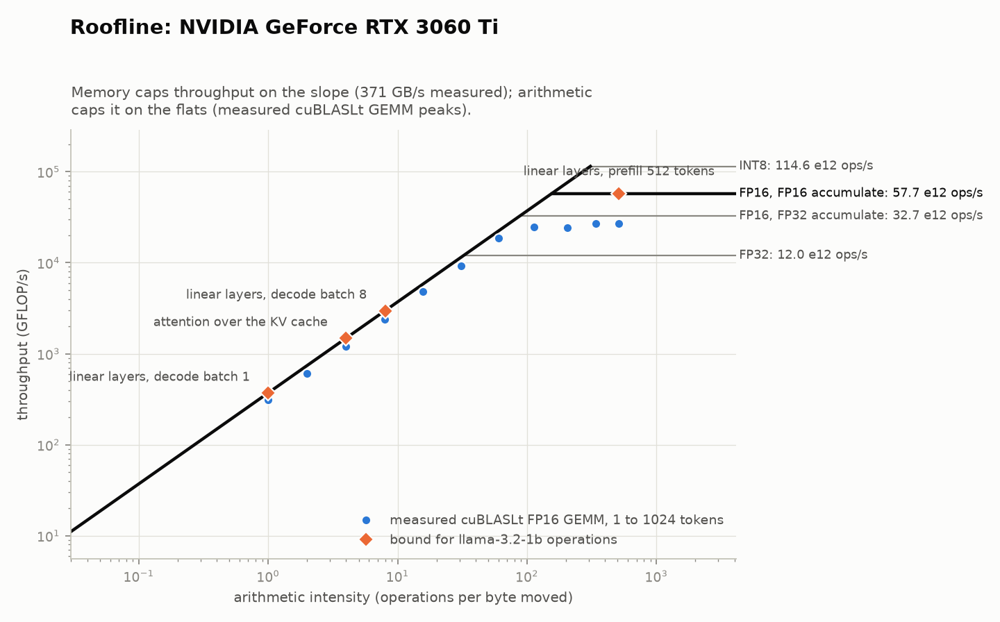

# Methodology

How kvbound is measured and what "correct" means for it: hardware ceilings, the performance model, the correctness
contract, workloads, metrics, and the provenance of the published numbers.

## Hardware and its measured ceilings

Two cards on a Windows desktop: an RTX 3060 Ti (Ampere, 8 GB) and an RTX 4070 (Ada, 12 GB). Every ceiling is measured
by the repository's own microbenchmarks (`make microbench`, [`microbench/`](../microbench/)); the spec sheets in
[`configs/devices/`](../configs/devices/) are only a fallback.

| Quantity | RTX 3060 Ti | RTX 4070 | Source |
| --- | --- | --- | --- |
| Memory bandwidth beyond cache, best 2 ms burst | 415 GB/s (93% of the 448 GB/s spec) | 475 GB/s | `kvb-bandwidth_sweep` |
| Memory bandwidth beyond cache, sustained 0.1 s | about 367 GB/s | about 449 GB/s | `kvb-bandwidth_sweep` |
| Dependent-load latency, L1 / L2 / DRAM | about 21 / 135 / 312 ns | about 14 / 172 / 247 ns | `kvb-pointer_chase` |
| GEMM peak, FP16 with FP32 accumulate | 32.7 TFLOPS | 59.1 TFLOPS | `kvb-gemm_peak` (cuBLASLt) |
| GEMM peak, FP16 with FP16 accumulate / INT8 | 57.7 TFLOPS / 114.6 TOPS | 91.5 TFLOPS / 215.2 TOPS | `kvb-gemm_peak` |
| GEMM peak, FP8 E4M3 | not supported | 118.3 TFLOPS | `kvb-gemm_peak` |
| L2 cache, as the driver reports it | 3 MiB | 36 MiB | device query |

The best burst is the bandwidth ceiling; the sustained figure is lower because other desktop programs take turns on
the GPU. The 3060 Ti's spec sheet lists a 4 MB L2, the driver 3 MiB.

## The performance model

[`python/kvbound/perfmodel/`](../python/kvbound/perfmodel/) bounds the latency of a forward pass from below. Each
operation must move some bytes and do some arithmetic, and neither can beat its ceiling:

```text
time(op) >= max(bytes / memory bandwidth, operations / peak arithmetic rate)
```

A pass is the sum over its operations. The model counts only unavoidable work: every weight read once per step, every
cached key and value read once per decode step, the matrix arithmetic done once. Launch overhead, elementwise kernels
and sampling are left out, so a real engine is always slower. The arithmetic ceiling is the FP16-accumulate peak, the
faster FP16 mode, so the bound also holds for kernels that accumulate in FP32. A weight costs 2 bytes in FP16, 1 in
`int8_pc` and 0.5 + 2/128 in `int4_g`, scales included.

At batch 1 a decode step multiplies one vector by every matrix and the weights dominate the bytes, so the bound
reduces to a decode ceiling of memory bandwidth over the bytes of weights read per token. TinyLlama 1.1B reads
2.07 GB per token in FP16 and Llama 3.2 1B 2.47 GB, which gives ceilings of 200 and 168 tokens/s on the 3060 Ti.
TinyLlama's FP16 floor, the weights read once, is 5.00 ms on the 3060 Ti and 4.37 ms on the 4070. A long prompt is the
opposite case: all its tokens pass through each matrix together and the tensor cores set the limit. TinyLlama's
1,024-token prompt is 1.98 TFLOP of matrix products, 60.7 ms at the 3060 Ti's 32.7 TFLOPS. "Share of the ceiling"
is a measured decode rate over the model's bound for the same precision at the middle of the generated span (128
prompt tokens plus 64), as [`bench.py`](../python/kvbound/bench.py) records it; `make predict` prints the bound.



## Correctness

The engine is correct when it matches a reference model within FP16 noise at every intermediate tensor and in tokens.

- **Reference models.** [`python/kvbound/ref/`](../python/kvbound/ref/) holds Llama (RMSNorm, RoPE, grouped-query
  attention, SwiGLU) and Whisper, written from scratch in PyTorch and tested against Hugging Face Transformers.
- **Golden tensors.** [`golden.py`](../python/kvbound/golden.py) stores the reference's FP32 activations at every
  capture site (the embedding; per layer `attn_norm`, `attn_out`, `resid_mid`, `mlp_norm`, `mlp_out`, `resid_post`;
  the final norm; the logits) for four fixed prompts, and the limits in a manifest that the C++ and Python tests both
  read. FP32 implementations must reach relative RMS error 1e-5 and cosine 0.99999. FP16 limits are four times the
  error PyTorch's own FP16 forward shows against the goldens, a line through depth stored per site; teacher-forced
  argmax mismatches and mean KL divergence of the logits are held to four times PyTorch's FP16 values (at least one
  mismatch is allowed). FP32 CPU math differs in its last bits between machines, so real-model manifests are kept per
  GPU, `data/golden/<model>/<device id>.json`.
- **Tokens.** Greedy output must equal the reference's token for token on every golden prompt. Both models pass, and
  Llama 3.2's worst intermediate activation sits at 18% of its FP16 limit, as on TinyLlama.
- **A design constraint.** Wide products that accumulate in FP16 fail the per-site limits, so the engine accumulates
  in FP32, whose tensor-core peak on the 3060 Ti is 32.7 TFLOPS against 57.7.
- **Quantized checkpoints.** The reference loads a quantized file by dequantizing its stored integers and scales, each
  scale rounded to FP16 before its integers are chosen, so it computes exactly the values the engine multiplies by.
  The engine is held to the same FP16 limits against this dequantizing reference. On the FP16 checkpoint the reference
  scores WikiText-2 perplexity 8.8722 and the engine 8.8723.
- **Fixtures and CI.** [`fixtures/tiny-llama/`](../fixtures/tiny-llama/) and
  [`fixtures/tiny-whisper/`](../fixtures/tiny-whisper/) are committed 2-layer random models with goldens and limits.
  CI has no GPU, so `make test` runs the C++ and Python tests against them. `make test-gpu` adds every kernel against
  torch and the engine against the fixture goldens, `make test-real` the reference against Hugging Face and the engine
  against the reference on the real checkpoints, and `make sanitize` runs compute-sanitizer (memcheck, racecheck,
  initcheck).

The speech model's criteria, which allow FP16 near-ties against Hugging Face, are in [`whisper.md`](whisper.md).

## Workloads

Requests are traces of token ids ([`workload.py`](../python/kvbound/workload.py),
[`configs/workloads/`](../configs/workloads/)), so every engine that replays a trace processes the same tokens.
Prompt ids are seeded random draws and decoding is greedy with EOS ignored, so each request produces exactly the
tokens the trace asks for. Each workload is 48 requests, seed 0, with a context limit of 1,024 tokens.

| Workload | Prompt tokens | Output tokens |
| --- | --- | --- |
| `fixed` | 256 | 128 |
| `uniform` | uniform, 32 to 512 | uniform, 16 to 256 |
| `longtail` | lognormal, median 64, sigma 1.0, clipped to 8 to 640 | lognormal, median 48, sigma 1.0, clipped to 4 to 384 |

Requests are queued at time zero, or arrive as a Poisson process at a given rate (2, 4, 8 and 16 per second in
`make serve-load`), drawn from a separate random stream so that lengths and ids do not depend on the rate. The
precision runs serve 96 `fixed` requests at once. Every serving run gets a KV pool of the same bytes, 8 sequences of
1,024 FP16 tokens: 176 MiB for TinyLlama, 256 MiB for Llama 3.2. The paged policy cuts it into 16-token blocks for up
to 64 sequences. Batch-1 runs use a 128-token prompt and 128 new tokens, and a 1,024-token prompt for the first token.

## Metrics

Defined in [`record.py`](../python/kvbound/record.py) and [`serve.py`](../python/kvbound/serve.py); times are host
wall-clock with GPU work synchronized.

| Metric | Definition |
| --- | --- |
| Decode tokens/s, batch 1 | Inverse of the median step between consecutive tokens of a run; median over 10 runs after 2 discarded warmups |
| TTFT, batch 1 | From submitting a prompt already on the device to the first generated token: prefill plus one sampling step |
| TTFT, serving | Per request, from its arrival to its first token; median over requests |
| TPOT | Per request, (time of last token - time of first token) / (tokens - 1); median over requests |
| Serving tokens/s | Generated tokens over the length of a pass; median of 3 passes after 1 warmup |
| Sequences at once | Most sequences processed in one step |
| Reserved KV holding tokens | Share of positions in blocks assigned to sequences that hold a token, weighted by step time |
| Bits per weight | Bytes of all weight tensors over the parameter count, scales and norm gains included: 4.13 for `int4_g` (4 bits and one FP16 scale per 128 weights, every matrix including the embedding), 8.01 for `int8_pc` |

**Perplexity.** The raw WikiText-2 test split, joined with blank lines and tokenized once with the model's tokenizer
(one BOS at the start), is cut into non-overlapping 1,024-token windows. Within a window position i predicts token
i + 1, so the first token of each window is context only. Perplexity is exp(total NLL / predicted tokens), the NLL
summed in float64, from the engine's logits ([`evals/perplexity.py`](../python/kvbound/evals/perplexity.py)). The
dataset file is pinned to a commit of its Hugging Face repository and checked against its sha256. Other stacks are
scored with the same windows and arithmetic from their own logits or log-probabilities, not with their own perplexity
tools; on unquantized weights all five engines agree within 0.07%.

## Measurement protocol and provenance

- **Records.** Every number comes from a JSON record under `results/raw/<device id>/`, one per run, written only by
  `kvbound.record`. A record holds the parameters, the metrics with the raw per-iteration samples behind them, NVML
  samples taken during the run, and a fingerprint: GPU name and UUID (which give the device id, e.g.
  `rtx3060ti-fd7b40d5`), driver, power limit, OS, toolchain versions and git commit. A record of an outside stack must
  also name the stack's version or release tag, its weight format and its bits per weight. Benchmarks refuse to run
  on uncommitted code unless given `--allow-dirty`, which tags the record `dirty`.
- **Clocks.** Under Windows (WDDM) GPU clocks cannot be locked. Every record is tagged `os=windows` (`os=wsl` for
  vLLM and TensorRT-LLM under WSL2), and `clock_varied` when the slowest busy SM clock sample is below 95% of the
  fastest. No record comes from native Linux with locked clocks.
- **Median step.** The cards share a desktop, and a program that takes the GPU delays a few steps of a run. That
  lengthens the mean step and leaves the median where it is, so decode on the 3060 Ti is read by the median step;
  every record keeps both readings. In the 2026-11-17 session 14 of 34 decode runs had a mean step 3.1% to 6.3% longer
  than the median. In the 2026-11-18 session, with the desktop kept quiet, the two readings of its 22 decode runs
  differ by at most 0.87% and the three passes of each serving run are within 0.8% of each other. On the RTX 4070 the
  two readings agree within 0.5%. TTFT and serving throughput have no second reading.

| Data | Card | Date | Commit | Driver |
| --- | --- | --- | --- | --- |
| Latency and GEMM microbenchmarks | RTX 3060 Ti | 2026-11-11 | `40e9095` | 576.02 |
| Bandwidth microbenchmark | RTX 3060 Ti | 2026-11-12 | `b30521a` | 576.02 |
| Microbenchmarks | RTX 4070 | 2026-11-14 | `1f50c54` | 617.42 |
| Engine ablation pairs | RTX 4070 | 2026-11-17 | `bdcdb3d` | 617.42 |
| `make precision`, `make serve`, `make serve-load` | RTX 3060 Ti | 2026-11-17 | `c442759` | 576.02 |
| `make bench` and the engine ablation pairs | RTX 3060 Ti | 2026-11-18 | `4089b55` | 576.02 |
| Perplexity of `int4_g.mse` / AWQ / GPTQ and rotation variants | RTX 3060 Ti | 2026-11-13 / 11-17 / 11-19 | `b724c45` / `7a36948` / `d360ec1` | 576.02 / 576.02 / 621.24 |
| Production comparison: kvbound and llama.cpp | RTX 3060 Ti | 2026-11-19 | `d360ec1` | 621.24 |
| Production comparison: vLLM and TensorRT-LLM / ExLlamaV3 | RTX 3060 Ti | 2026-11-19 | `52963be` / `d6a1c38` | 621.24 |

kvbound was measured again beside llama.cpp on the newer driver, so the same quantity can read differently in two
documents, by up to about 2%: TinyLlama's FP16 batch-1 decode reads 176 tokens/s in `make precision`, 177 in
`make bench` and 180 in the production comparison. Each document states which records it uses.

## Reproducing

```sh
make setup                                     # TORCH=cu128 on GPU machines, TORCH=cpu elsewhere
make reproduce MODEL=tinyllama-1.1b DEVICE=rtx3060ti   # checkpoint to figures, every engine record
make doctor fetch golden quantize MODEL=...    # clock state, pinned checkpoint, goldens, INT8 and INT4 copies
make test test-gpu test-real sanitize          # fixtures, kernels and engine, real checkpoint, compute-sanitizer
make microbench                                # hardware ceilings and the KV layout benchmark
make bench serve serve-load precision MODEL=...     # batch 1, the three workloads, arrivals, each precision
make profile counters step-counters MODEL=...  # Nsight Systems and Nsight Compute
make report predict MODEL=... DEVICE=...       # figures into reports/<device>/, bounds from the model
make bench-hf MODEL=...                        # Hugging Face baseline
make fetch-llamacpp eval-llamacpp bench-llamacpp serve-llamacpp profile-llamacpp MODEL=...
make fetch-exllamav3 eval-exllamav3 bench-exllamav3 MODEL=...
make setup-stacks quantize-stacks eval-stacks bench-stacks serve-stacks MODEL=...   # Linux or WSL2
```

On a card without a committed golden manifest the benchmarks stop at the dirty tree: commit
`data/golden/<model>/<device>.json` and run again. Outside stacks live under `$KVBOUND_EXT` (default `ext/`), each
release pinned by tag and checksum.
