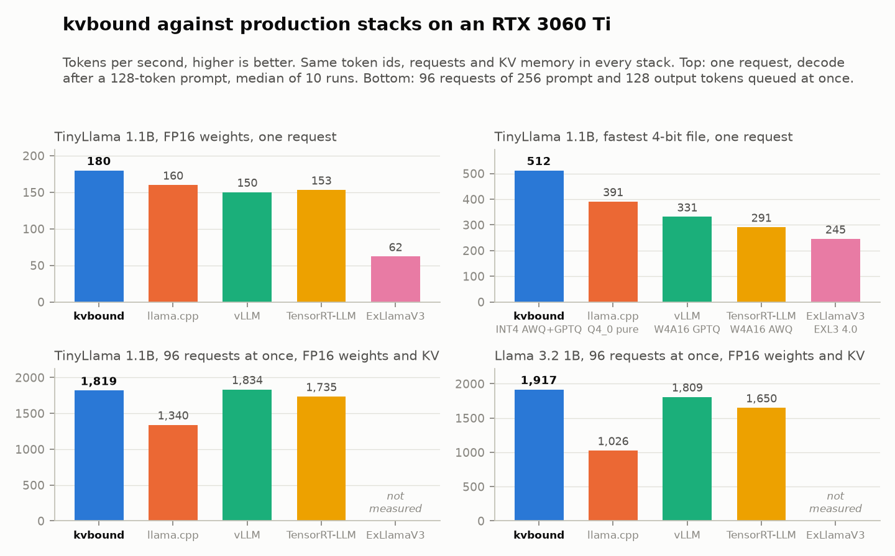
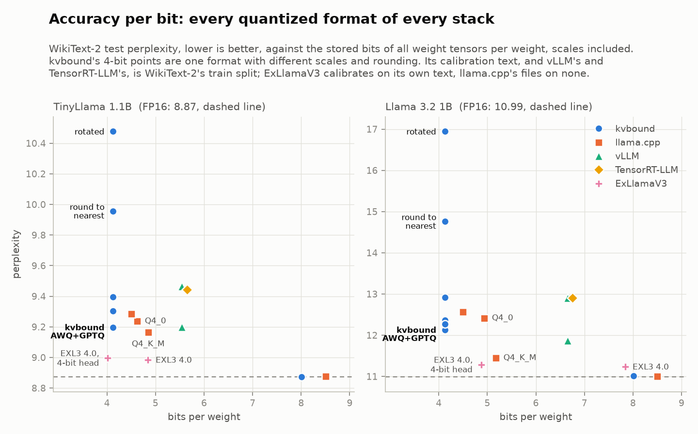

# kvbound against production stacks

kvbound is placed next to inference stacks that people deploy, on the same card, with the same token ids, the same
requests and the same KV memory. For each measurement this document states whether kvbound is ahead, level or
behind, and what in the engines explains it.

> **Data.** RTX 3060 Ti, driver 621.24, records of 2026-11-19 under `results/raw/rtx3060ti-fd7b40d5/`. kvbound at
> commit `d360ec1` and llama.cpp `b12503` (the official Windows CUDA 12 build) ran together, 96 records per model:
> kvbound through the modules behind `make precision`, `serve-load` and `bench`, then `make eval-llamacpp
> bench-llamacpp serve-llamacpp`. kvbound was measured again beside llama.cpp, so its figures differ slightly from
> other documents, whose kvbound records are of 2026-11-17 and 2026-11-18 on driver 576.02: FP16 decode on TinyLlama
> reads 180 tokens/s here and 177 there. kvbound's FP16, INT8, `int4_g` and `int4_g.awq` perplexities are records of
> 2026-11-17 from the same checkpoint files. vLLM, TensorRT-LLM and ExLlamaV3 were recorded later the same day (`make
> bench-stacks eval-stacks serve-stacks`, `make bench-exllamav3 eval-exllamav3`) without measuring kvbound again;
> every kvbound row is its Windows record. Nsight Systems summaries are under `results/profiles/`, from 10:50 UTC on.

## Question

How does an engine built to expose where time and memory go compare with deployed stacks on the same hardware and
inputs: for one request, under arrivals, with more requests than the KV memory holds, and in accuracy per bit?

## Stacks and setup

| Stack | Where | What was compared |
| --- | --- | --- |
| llama.cpp `b12503` | RTX 3060 Ti, Windows | Accuracy per bit, one request, serving, kernels under Nsight Systems |
| vLLM 0.34.0 | RTX 3060 Ti, WSL2 | Accuracy per bit, one request, serving with FP16 weights |
| TensorRT-LLM 1.2.1, PyTorch backend | RTX 3060 Ti, WSL2 | Accuracy per bit, one request, serving with FP16 weights |
| ExLlamaV3 1.6.7 | RTX 3060 Ti, Windows | Accuracy per bit, one request |
| Qualcomm AI Hub export of Llama 3.2 1B | Snapdragon NPU (Galaxy S25, S26) | Memory design and per-graph latency |

The models are TinyLlama 1.1B and Llama 3.2 1B. vLLM and TensorRT-LLM are Linux packages and run under WSL2 on the
same machine and card, each from its own pinned environment (`configs/stacks/`, `make setup-stacks`); their records
carry the tag `os=wsl`. ExLlamaV3 runs on Windows from its official wheel.

## Method

- **Same inputs.** Prompts are the seeded token ids of `kvbound.bench.random_prompt` and `kvbound.workload.trace`,
  sent to every stack as ids. Decoding is greedy with EOS ignored, so every request produces the tokens the trace
  asks for.
- **Routes.** kvbound runs `kvb-bench`, one process. llama.cpp runs `llama-server` with all layers on the GPU and
  flash attention on, taking streamed `POST /completion` calls on 127.0.0.1; vLLM and TensorRT-LLM run their own
  OpenAI-compatible servers on 127.0.0.1 ([`linux_stacks.py`](../python/kvbound/baselines/linux_stacks.py)).
  ExLlamaV3 runs in process through its `Generator` ([`exllamav3.py`](../python/kvbound/baselines/exllamav3.py)).
  Server times are taken by the client as each token arrives, with the server's own timings kept in the record. For
  one request llama.cpp's server decode rate equals the client's to 0.1 tokens/s, so HTTP is not part of the decode
  figures.
- **Same KV memory.** llama.cpp gets a unified cache of exactly the bytes of kvbound's pool (8 sequences of 1,024
  FP16 tokens): 8,192 cells as `f16`, or 15,360 as `q8_0`, the counterpart of kvbound's INT8 cache. vLLM gets the
  pool's bytes (`--kv-cache-memory-bytes`) in 16-token blocks like kvbound; TensorRT-LLM the pool's 8,192 tokens in
  its 32-token blocks.
- **Non-default settings**, named in the records. Prefix caching and block reuse are off, so that no pass reuses
  another's prompt. TensorRT-LLM pads batches to the sizes it captured CUDA graphs for; without the padding its median
  time per token under load was about twice as long in a trial run.
- **Perplexity and bits per weight** follow [methodology.md](methodology.md): kvbound's windows and float64
  arithmetic, applied to logits read from `llama.dll` and to each other stack's log-probabilities or logits
  (`llama-perplexity` scores differently and is not used); bits are the bytes of all weight tensors over the
  parameter count, scales included, 4.13 for kvbound's `int4_g`.
- **Formats.** kvbound's are in [quantization.md](quantization.md). llama.cpp's `Q4_0` is 4 bits with one FP16 scale
  per 32 weights, rounded to nearest, with the vocabulary matrix kept at 6.56 bits; `Q4_0_PURE` (`--pure`) quantizes
  every matrix that way and is the closest counterpart of `int4_g`; `Q4_K_M` mixes 4-bit and 6-bit blocks with 6-bit
  block scales; none uses an importance matrix. The W4A16 files (4-bit weights, 16-bit activations) of vLLM and
  TensorRT-LLM are made by each stack's own tool on the 128 calibration windows kvbound's AWQ and GPTQ use:
  llm-compressor (AWQ and GPTQ) and NVIDIA Model Optimizer (`awq_lite`), in groups of 128. Both leave the embedding
  and the vocabulary matrix in FP16, so they hold 5.5 to 6.8 bits per weight. TensorRT-LLM 1.2.1 loads no GPTQ
  checkpoint. ExLlamaV3's EXL3 is not a grid of scalar levels: the converter rotates each matrix and codes its
  weights with a trellis, calibrated on 250 rows of 2,048 tokens of its bundled web text, code and articles, in which
  no article title or paragraph of the WikiText-2 test split was found. *EXL3 4.0* is the default (6 bits for the
  vocabulary matrix, embedding in FP16); *4-bit head and embedding* (`--head_bits 4 --embed_bits 4`) has the scope
  of `int4_g`, and still holds 4.88 bits per source weight on Llama 3.2, whose tied vocabulary matrix is stored twice.

**What cannot be equalized.** llama.cpp admits by free slot and fails requests when its cache overflows;
TensorRT-LLM's default admission reserves a request's full length and does not preempt; kvbound admits by free blocks
and preempts. The servers sample on the CPU and stream each token over HTTP, where `kvb-bench` takes the argmax on the
GPU inside one process ([`llamacpp_serve.py`](../python/kvbound/baselines/llamacpp_serve.py)). vLLM and TensorRT-LLM
run under WSL2 against kvbound's Windows records; kvbound built and run inside WSL decoded within 3% of its Windows
figures in a trial run that was not recorded. The serving results say where these differences matter.

## Results

### Summary

| RTX 3060 Ti | kvbound | llama.cpp | vLLM | TensorRT-LLM | ExLlamaV3 |
| --- | --- | --- | --- | --- | --- |
| TinyLlama, FP16 decode, one request, tokens/s | 180 | 160 | 150 | 153 | 62 |
| TinyLlama, fastest 4-bit decode, tokens/s | 512 | 391 | 331 | 291 | 245 |
| TinyLlama, first token of a 1,024-token prompt, FP16, ms | 72.6 | 69.9 | 86.1 | 86.2 | 95.0 |
| TinyLlama, 96 requests at once, FP16, tokens/s | 1,819 | 1,340 | 1,834 | 1,735 | not measured |
| Llama 3.2, 96 requests at once, FP16, tokens/s | 1,917 | 1,026 | 1,809 | 1,650 | not measured |
| TinyLlama, best perplexity under 5 bits per weight (FP16: 8.87) | 9.20 at 4.13 | 9.16 at 4.85 | none under 5 | none under 5 | 8.99 at 4.85, 9.00 at 4.02 |
| Llama 3.2, best perplexity under 5 bits per weight (FP16: 10.99) | 12.13 at 4.13 | 12.41 at 4.94 | none under 5 | none under 5 | 11.28 at 4.88 |

- **One request at a time, kvbound decodes fastest of the five**: by 8 to 20% with FP16 weights against llama.cpp,
  vLLM and TensorRT-LLM, and by 1.3 to 2.1 times at 4 bits against all four.
- **Under load, kvbound and vLLM are within 1% of each other on TinyLlama**; on Llama 3.2 kvbound serves 6% more.
  TensorRT-LLM is 5 to 14% behind with 96 requests at once and llama.cpp 26 to 46% behind.
- **On a long prompt llama.cpp is ahead of kvbound**, and kvbound is ahead of the other three.
- **In accuracy per bit kvbound is behind.** At 4 bits ExLlamaV3's format loses 0.12 of perplexity on TinyLlama
  where kvbound's best checkpoint loses 0.32, and 0.30 against 1.14 on Llama 3.2 with 4.9 bits against 4.1. kvbound
  has nothing between 4 and 8 bits, where llama.cpp's Q4_K_M scores better on both models and vLLM's GPTQ file, with
  an FP16 vocabulary matrix, on Llama 3.2.

### One request

Decode is the median of 10 runs of 128 generated tokens after a 128-token prompt. First token is the median of 10
runs, at the client (in process for kvbound and ExLlamaV3), for prompts of 128 and 1,024 tokens.

| One request | TinyLlama: decode, tokens/s | First token, 128 | First token, 1,024 | Llama 3.2: decode, tokens/s | First token, 128 | First token, 1,024 |
| --- | --- | --- | --- | --- | --- | --- |
| kvbound FP16 | 179.9 | 10.4 ms | 72.6 ms | 156.3 | 10.8 ms | 69.5 ms |
| llama.cpp F16 | 159.9 | 17.9 ms | 69.9 ms | 138.2 | 13.7 ms | 65.7 ms |
| TensorRT-LLM F16 | 153.2 | 22.4 ms | 86.2 ms | 144.7 | 17.3 ms | 74.5 ms |
| vLLM F16 | 150.2 | 21.9 ms | 86.1 ms | 135.8 | 23.1 ms | 83.5 ms |
| ExLlamaV3, unquantized | 62.1 | 34.8 ms | 95.0 ms | 77.3 | 26.5 ms | 86.1 ms |
| kvbound INT8 (`int8_pc`) | 315.9 | 12.1 ms | 71.5 ms | 283.8 | 11.9 ms | 70.2 ms |
| llama.cpp Q8_0 | 261.3 | 17.7 ms | 64.1 ms | 229.0 | 22.0 ms | 69.8 ms |
| kvbound INT4, AWQ and GPTQ | 512.0 | 11.2 ms | 71.0 ms | 474.1 | 11.0 ms | 69.7 ms |
| kvbound INT4, AWQ | 511.2 | 11.3 ms | 70.9 ms | 474.7 | 11.1 ms | 69.7 ms |
| kvbound INT4, round to nearest (`int4_g`) | 510.0 | 11.3 ms | 71.1 ms | 472.4 | 11.1 ms | 69.7 ms |
| llama.cpp Q4_0, every matrix (`--pure`) | 390.7 | | | 355.7 | | |
| llama.cpp Q4_0 | 381.3 | 24.9 ms | 78.8 ms | 337.0 | 17.5 ms | 72.3 ms |
| llama.cpp Q4_K_M | 367.2 | 20.6 ms | 70.9 ms | 319.9 | 17.7 ms | 65.7 ms |
| vLLM W4A16, GPTQ | 331.2 | 25.7 ms | 77.1 ms | 266.0 | 19.4 ms | 76.4 ms |
| vLLM W4A16, AWQ | 327.5 | 26.1 ms | 77.5 ms | 257.3 | 22.1 ms | 76.8 ms |
| TensorRT-LLM W4A16, AWQ | 290.9 | 29.1 ms | 73.9 ms | 275.7 | 22.0 ms | 73.2 ms |
| ExLlamaV3 EXL3 4.0 | 245.2 | 21.8 ms | 87.5 ms | 251.0 | 18.6 ms | 81.7 ms |
| ExLlamaV3 EXL3 4.0, 4-bit head and embedding | 242.7 | 21.6 ms | 85.9 ms | 261.3 | 18.8 ms | 79.1 ms |

kvbound's FP16 decode is 90% and 93% of the card's bandwidth ceiling for the two models; llama.cpp's is 80% and 83%.
TensorRT-LLM's TinyLlama runs spread more than the others': its 10 runs of the 4-bit file range from 252 to 305
tokens/s and read 336 after the long prompt. ExLlamaV3's unquantized path checks perplexity and is not a speed
baseline.

**Where a decode step goes.** kvbound and llama.cpp replay a decode step from a CUDA graph, which hides its kernels
from Nsight Systems, so each is traced with graphs off: 255 or 256 decode steps of TinyLlama after a prompt of one or
two tokens (`make profile`, `make profile-llamacpp`). The first four rows are GPU time per step by kind of kernel;
llama.cpp's prompt kernels, 0.02 ms per step or less, are left out. The other stacks were not profiled.

| ms per decode step, TinyLlama | kvbound FP16 | llama.cpp F16 | kvbound INT4 | llama.cpp Q4_0 |
| --- | --- | --- | --- | --- |
| Matrix products | 5.06 | 5.32 | 1.50 | 1.78 |
| Quantizing the activations to 8 bits | | | | 0.19 |
| Attention | 0.19 | 0.14 | 0.19 | 0.14 |
| Norms, RoPE, cache write and the rest | 0.16 | 0.22 | 0.16 | 0.21 |
| All kernels of a step | 5.41 | 5.67 | 1.85 | 2.32 |
| Kernel launches per step | 204 | 292 | 204 | 425 |
| Measured step, graphs on, not traced (1 / decode rate) | 5.56 | 6.25 | 1.96 | 2.62 |
| Measured step less its kernels | 0.15 | 0.58 | 0.11 | 0.30 |

The last row subtracts numbers from two different runs, so it is good to about 0.05 ms. One llama.cpp trace read its
products 20% slower than two repeats that agree to 0.1%; the repeats are used. kvbound's repeats moved by about 1%.

### First token

The table gives llama.cpp's whole wait at the client, including HTTP. Its server's prompt evaluation alone takes
12.2 to 15.3 ms for 128 tokens and 58.6 to 67.9 ms for 1,024 across F16, Q8_0 and Q4_0 on both models; the client's
fastest run is 0.6 to 1.3 ms above the server's fastest in every case, and its medians are noisy on this machine. The
1,024-token runs give llama.cpp one batch of 1,024 (`--ubatch-size 1024`), as kvbound runs it; in batches of 512, the
server's default, its median prompt times are 68.0 to 70.5 ms on TinyLlama and 60.8 to 65.5 ms on Llama 3.2.

For a short prompt kvbound is 1 to 4 ms ahead of llama.cpp; for a long one llama.cpp is ahead, by 4 to 6 ms with FP16
weights and by up to 12 ms with 8-bit ones. vLLM and TensorRT-LLM take about twice as long as kvbound for a short
prompt (17 to 29 ms against 10 to 11) and 3 to 14 ms longer for a 1,024-token one.

### Serving

All servers get the same pool bytes and the same trace. `longtail` is 48 requests with long-tailed prompt and output
lengths arriving as a Poisson process; `fixed` is 96 requests of 256 prompt tokens and 128 output tokens, all at
time zero. No request failed in any run. vLLM and TensorRT-LLM are served with FP16 weights only, ExLlamaV3 not at
all.

| Tokens/s, FP16 KV, same pool bytes | `longtail`, 2 per s | 4 per s | 8 per s | 16 per s | `fixed`, 96 at once |
| --- | --- | --- | --- | --- | --- |
| **TinyLlama** | | | | | |
| kvbound FP16 | 182 | 348 | 613 | 942 | 1,819 |
| vLLM F16 | 181 | 346 | 611 | 943 | 1,834 |
| TensorRT-LLM F16 | 181 | 346 | 610 | 932 | 1,735 |
| llama.cpp F16 | 181 | 343 | 599 | 877 | 1,340 |
| kvbound INT4 | 186 | 365 | 674 | 1,143 | 2,334 |
| llama.cpp Q4_K_M | 185 | 362 | 672 | 1,136 | 1,817 |
| llama.cpp Q4_0 | 185 | 362 | 678 | 1,109 | 1,660 |
| **Llama 3.2** | | | | | |
| kvbound FP16 | 181 | 343 | 598 | 896 | 1,917 |
| vLLM F16 | 180 | 335 | 581 | 842 | 1,809 |
| TensorRT-LLM F16 | 180 | 339 | 592 | 876 | 1,650 |
| llama.cpp F16 | 180 | 334 | 567 | 743 | 1,026 |
| kvbound INT4 | 186 | 363 | 670 | 1,140 | 2,461 |
| llama.cpp Q4_K_M | 185 | 359 | 652 | 1,010 | 1,284 |
| llama.cpp Q4_0 | 185 | 360 | 655 | 979 | 1,225 |

| Median time to first token, `longtail`, ms | 2 per s | 4 per s | 8 per s | 16 per s |
| --- | --- | --- | --- | --- |
| TinyLlama, kvbound FP16 / INT4 | 13.5 / 10.6 | 12.2 / 9.2 | 13.0 / 9.9 | 14.7 / 11.8 |
| TinyLlama, vLLM F16 | 25.2 | 23.5 | 25.4 | 26.3 |
| TinyLlama, TensorRT-LLM F16 | 33.1 | 28.3 | 30.3 | 41.6 |
| TinyLlama, llama.cpp F16 / Q4_0 | 31.3 / 28.5 | 28.6 / 27.2 | 29.3 / 28.2 | 33.1 / 27.0 |
| Llama 3.2, kvbound FP16 / INT4 | 13.8 / 9.8 | 13.1 / 10.2 | 14.2 / 10.5 | 15.7 / 11.6 |
| Llama 3.2, llama.cpp F16 / Q4_0 | 33.2 / 26.0 | 33.3 / 25.8 | 33.6 / 28.6 | 33.9 / 27.6 |

**Requests arriving over time.** At 2 and 4 requests per second the trace sets the throughput: every server finishes
requests about as fast as they arrive, within 3% of kvbound, and the difference shows in latency. kvbound's median
time per output token with FP16 weights is 5.9 to 6.6 ms on TinyLlama against llama.cpp's 7.0 to 7.7 ms up to 8 per
second. At 16 per second llama.cpp's throughput is 7% lower (FP16) and 1 to 3% lower (4-bit) on TinyLlama, and 17%
and 11 to 14% lower on Llama 3.2. llama.cpp's first token takes 25 to 34 ms at every rate, although the median prompt
of this trace is 68 tokens and the same server evaluates a 128-token prompt in 12 to 15 ms; where the rest goes was
not measured, and the HTTP path is part of it.

**More requests than the memory holds.**

| `fixed`, 96 requests at once | TinyLlama: tokens/s | Sequences running | Median ms per token | Llama 3.2: tokens/s | Sequences running | Median ms per token |
| --- | --- | --- | --- | --- | --- | --- |
| kvbound FP16, FP16 KV | 1,819 | 30 | 12.4 | 1,917 | 30 | 11.8 |
| llama.cpp F16, `f16` KV | 1,340 | 21 | 14.6 | 1,026 | 21 | 19.3 |
| kvbound FP16, INT8 KV | 2,182 | 58 | 19.0 | 2,230 | 58 | 18.3 |
| llama.cpp F16, `q8_0` KV | 1,439 | 40 | 25.0 | 1,078 | 40 | 33.7 |
| kvbound INT4, FP16 KV | 2,334 | 30 | 9.5 | 2,461 | 30 | 9.0 |
| llama.cpp Q4_K_M, `f16` KV | 1,817 | 21 | 10.8 | 1,284 | 21 | 15.6 |
| llama.cpp Q4_0, `f16` KV | 1,660 | 21 | 11.8 | 1,225 | 21 | 16.3 |
| kvbound INT4 (AWQ, GPTQ), INT8 KV | 2,440 | 58 | 17.9 | 2,244 | 58 | 19.3 |
| llama.cpp Q4_0, `q8_0` KV | 1,654 | 40 | 22.4 | 1,190 | 40 | 30.9 |

A diagnostic run, not a record, times llama.cpp's engine alone on 21 parallel sequences of this shape with the
release's `llama-batched-bench`, which calls the same decode without a server, a sampler or HTTP (`-npp 256 -ntg 128
-npl 1,21 -c 8192 -b 1024 -ub 1024 -ngl all -fa on`):

| Step for 21 rows, ms | TinyLlama F16 | TinyLlama Q4_0 | Llama 3.2 F16 | Llama 3.2 Q4_0 |
| --- | --- | --- | --- | --- |
| llama.cpp engine alone (`llama-batched-bench`) | 10.2 | 7.3 | 11.3 | 8.2 |
| llama-server, median time per token (table above) | 14.6 | 11.8 | 19.3 | 16.3 |
| kvbound, 30 rows, median time per token | 12.4 | 9.5 | 11.8 | 9.0 |

### Accuracy per bit

WikiText-2 perplexity with an FP16 KV cache. Rows below 8 bits are in order of Llama 3.2 perplexity. The formats,
their calibration and the rotation experiments are analysed in [quantization.md](quantization.md).

| Weights | Bits per weight | TinyLlama 1.1B | Bits per weight | Llama 3.2 1B |
| --- | --- | --- | --- | --- |
| kvbound FP16 | 16 | 8.872 | 16 | 10.987 |
| llama.cpp F16 | 16 | 8.873 | 16 | 10.992 |
| vLLM F16 | 16 | 8.872 | 16 | 10.986 |
| TensorRT-LLM F16 | 16 | 8.873 | 16 | 10.993 |
| ExLlamaV3, unquantized | 16 | 8.872 | 16 | 10.987 |
| kvbound INT8 (`int8_pc`) | 8.01 | 8.873 | 8.01 | 11.015 |
| llama.cpp Q8_0 | 8.50 | 8.875 | 8.50 | 10.997 |
| ExLlamaV3 EXL3 4.0 | 4.85 | 8.985 | 7.84 | 11.239 |
| ExLlamaV3 EXL3 4.0, 4-bit head and embedding | 4.02 | 8.995 | 4.88 | 11.285 |
| llama.cpp Q4_K_M | 4.85 | 9.163 | 5.18 | 11.443 |
| vLLM W4A16, GPTQ | 5.54 | 9.200 | 6.65 | 11.876 |
| kvbound INT4, AWQ and GPTQ (`int4_g.awq-gptq`) | 4.13 | 9.197 | 4.13 | 12.130 |
| kvbound INT4, GPTQ (`int4_g.gptq`) | 4.13 | 9.309 | 4.13 | 12.369 |
| llama.cpp Q4_0 | 4.63 | 9.236 | 4.94 | 12.410 |
| llama.cpp Q4_0, every matrix (`--pure`) | 4.50 | 9.285 | 4.50 | 12.570 |
| TensorRT-LLM W4A16, AWQ | 5.65 | 9.443 | 6.75 | 12.901 |
| vLLM W4A16, AWQ | 5.54 | 9.464 | 6.65 | 12.905 |
| kvbound INT4, AWQ (`int4_g.awq`) | 4.13 | 9.396 | 4.13 | 12.912 |
| kvbound INT4, round to nearest (`int4_g`) | 4.13 | 9.956 | 4.13 | 14.762 |

All five engines score the unquantized weights within 0.07% of each other, so the protocol is the same everywhere and
differences further down are the formats', not the forward passes'.

## Analysis per stack

### llama.cpp

- **Ahead: decode of one request**, 13% with FP16 weights, 21 to 24% with 8-bit, 31 to 33% at 4 bits against Q4_0
  `--pure` and 39 to 48% against Q4_K_M. llama.cpp's step is 0.69 ms longer with FP16 weights and 0.66 ms at 4
  bits, nearly the same amount, which is why the ratio grows as the step shrinks.
  - *FP16: 0.26 ms in the products, 0.43 ms between kernels.* Both engines read the same 2.07 GB per step; kvbound's
    products stream it at 409 GB/s, where the card's measured bandwidth is 415, llama.cpp's at 389 GB/s. kvbound
    stacks q, k and v into one product and gate and up into another, 89 products per step; llama.cpp fuses gate, up
    and the activation but multiplies q, k and v separately, 133 products, and k and v are 1 MB each in this model,
    likely too small for a kernel to reach the full rate.
  - *4 bits: 0.28 ms in the products, 0.19 ms to quantize activations, 0.19 ms between kernels.* Q4_0 reads 599 MB
    per step where `int4_g` reads 533 MB (a scale per 32 weights instead of 128, and a 6.56-bit vocabulary matrix),
    0.18 ms at kvbound's rate. llama.cpp's quantized products are integer dot products, so a second kernel quantizes
    the activations to 8 bits before each one, 133 more launches per step; kvbound's kernel takes FP16 activations.
  - *Between kernels*, llama.cpp waits on the stream about 20 times per step and samples on the CPU from logits it
    copies back; kvbound waits once and takes the argmax on the GPU. Which of these the 0.2 to 0.4 ms are was not
    measured.
- **Ahead: more requests than the KV memory holds**, 1.3 to 1.5 times the tokens/s on TinyLlama and 1.9 to 2.1
  times on Llama 3.2.
  - *Admission.* A request here ends at 384 tokens. llama.cpp never preempts and fails every request in flight if its
    cache overflows, so all its slots must be able to finish: 8,192 cells over 384 is 21. kvbound admits by free
    blocks with one spare per growing sequence and preempts when the pool runs out
    ([static-vs-paged-memory.md](static-vs-paged-memory.md)), so it starts 30 sequences in the same bytes; with an
    8-bit cache, 58 against 40.
  - *Cost per row.* Going from 21 to 40 slots lengthens llama.cpp's FP16 step by 0.55 ms per added row on TinyLlama
    and 0.76 ms on Llama 3.2; going from 30 to 58 sequences lengthens kvbound's by 0.24 and 0.23 ms. Most of it is
    outside llama.cpp's engine: the server adds 4.4 to 4.5 ms to a 21-row step on TinyLlama and 8.0 to 8.1 ms on
    Llama 3.2 at both weight precisions. Llama 3.2's vocabulary is four times TinyLlama's (128,256 against 32,000)
    and the server samples every row on the CPU from its full logits, so work that grows with rows times vocabulary
    fits the pattern; which part of the server it is was not profiled.
  - Engine against engine the two are close, 21 rows in 10.2 ms against 30 in 12.4: the serving gap is admission plus
    the server's work per row, not faster kernels. The same cost decides what an 8-bit cache is worth: with FP16
    weights it raises kvbound's throughput by 20% and 16% and llama.cpp's by 7% and 5%; with 4-bit weights it
    changes either engine's by less than 10% in either direction.
- **Ahead: first token under load**, 9 to 16 ms at the median against 25 to 34 ms.
- **Level: accuracy at 16 and 8 bits**, within 0.05% from the same FP16 weights, each 8-bit format costing at most
  0.3%; **serving well below saturation**, within 3% at 2 and 4 requests per second, and 2% (TinyLlama) and 5%
  (Llama 3.2) behind at 8 per second with FP16 weights.
- **Level, with a caveat: accuracy at 4 bits.** Rounding to nearest, llama.cpp's format is much better (9.29 against
  9.96, 12.57 against 14.76): a scale per 32 weights instead of 128 costs 0.375 bits per weight, and a smaller group
  has a smaller largest weight to set its step. With AWQ's scales and GPTQ's rounding kvbound's 4.13-bit checkpoint
  beats both Q4_0 files on both models and is 0.03 behind Q4_K_M on TinyLlama with 0.72 fewer bits per weight, 0.69
  behind on Llama 3.2 with 1.05 fewer. The caveat: kvbound calibrates on 128 windows of the WikiText-2 train split
  and is scored on its test split, while the llama.cpp files use no data. An importance matrix (`llama-imatrix`) and a
  score of kvbound's checkpoints on text from another source are both needed before calling the 4-bit rows a win.
- **Behind: a long prompt**, 59 to 68 ms for 1,024 tokens where kvbound takes 69 to 73 ms. llama.cpp's source at the
  tag sends wide FP16 products to cuBLAS with FP16 accumulation (`batched_mul_mat_traits<GGML_TYPE_F16>` in
  `ggml-cuda.cu`) and quantized ones to its own integer kernels on 8-bit activations (`mmq.cu`); this was not
  profiled. kvbound accumulates every wide product in FP32, because FP16 accumulation fails its per-site error limits
  against the reference model, and the tensor cores deliver 58 TFLOPS with FP16 accumulation and 33 with FP32 (`make
  microbench`).
- **Behind: accuracy between 4 and 8 bits.** Q4_K_M spends 5.18 bits per weight on Llama 3.2 and scores 11.44 where
  kvbound's best scores 12.13; kvbound has no format between 4.13 and 8 bits to make that trade.
- **Behind: everything that is not the forward pass.** kvbound runs two Llama checkpoints and Whisper from token ids.
  Chat templates, samplers beyond greedy, grammars, other architectures, other GPUs and CPUs are out of scope.

### vLLM and TensorRT-LLM

- **Ahead: one request**, 17 to 20% with FP16 weights on TinyLlama and 8 to 15% on Llama 3.2, and 1.5 to 1.8 times
  at 4 bits. Part of the 4-bit gap is bytes: their files keep the vocabulary matrix in FP16 and a decode step reads
  it whole, 631 to 646 MB per token on TinyLlama against `int4_g`'s 533, and 1,027 to 1,043 MB against 637 on Llama
  3.2. That ratio, about 1.2 and 1.6, accounts for most of the gap on Llama 3.2 and the smaller part on TinyLlama.
  Neither stack was profiled, so the rest is not explained.
- **Ahead: first token**, about twice as fast for a short prompt and 3 to 14 ms faster for a long one; under load
  both stacks answer in 23 to 42 ms where kvbound takes 12 to 16.
- **Level: vLLM's serving.** vLLM is the closest stack. On TinyLlama it is within 1% at every arrival rate and with
  96 requests at once, where it runs the same 30 sequences from the same bytes: it pages its cache in 16-token blocks
  and preempts, as kvbound does. On Llama 3.2 kvbound serves 3% more at 8 requests per second and 6% more at 16 per
  second and with 96 at once.
- **Level under arrivals, ahead with 96 at once: TensorRT-LLM's serving**, within 3% while requests arrive and 5% and
  14% behind with 96 at once. Its default admission reserves a request's full length and does not preempt.
- **Level: AWQ accuracy.** On the same 128 windows AWQ scores 9.46, 9.44 and 9.40 on TinyLlama in vLLM, TensorRT-LLM
  and kvbound, and 12.90, 12.90 and 12.91 on Llama 3.2, although the three searches differ in detail.
- **Behind: GPTQ accuracy against vLLM.** vLLM's GPTQ scores 9.20 and 11.88, better than kvbound's GPTQ alone (9.31
  and 12.37); kvbound's GPTQ on top of AWQ equals it on TinyLlama (9.20) and stays behind on Llama 3.2 (12.13).
  vLLM's files spend 1.4 and 2.5 more bits per weight, on the FP16 vocabulary matrix. Calibration is not a caveat:
  all three use the same windows.

### ExLlamaV3

- **Ahead: decode, about twice as fast**, 512 against 243 to 245 tokens/s on TinyLlama and 474 against 251 to 261 on
  Llama 3.2. ExLlamaV3's rate barely depends on the bytes it reads: its two files differ by 1% on TinyLlama. A step
  of a 1B model there is bound by something other than memory bandwidth; what was not profiled.
- **Ahead: first token**, 11 and 70 to 71 ms against 19 to 22 and 79 to 87 ms with the 4-bit files.
- **Behind: accuracy per bit, without an in-domain caveat.** With every matrix near 4 bits EXL3
  scores 8.995 on TinyLlama at 4.02 bits per weight, 0.12 above FP16, where kvbound's best is 0.32 above at 4.13 and
  Q4_K_M 0.29 above at 4.85. On Llama 3.2 it is 0.30 above FP16 at 4.88 bits, where kvbound is 1.14 above at 4.13
  and Q4_K_M 0.45 above at 5.18. A rotation is part of that format, and rotation did not help kvbound's
  ([quantization.md](quantization.md)). The two are not the same experiment: kvbound rotates the residual stream once
  and keeps scalar groups of 128 with one scale each, and EXL3's parts were not tested separately.

### A static design on a phone NPU

Qualcomm's stock export of Llama 3.2 1B Instruct with 4-bit weights decodes at 58.2 and 59.9 tokens/s by per-graph
latency on the Hexagon NPU of a Galaxy S25 and S26 ([`qai_hub.py`](../python/kvbound/baselines/qai_hub.py)); kvbound
decodes the base model at 472 tokens/s with INT4 weights. A phone NPU running one sequence and a desktop card with a
220 W power limit are not a comparison of engines. The lesson is in the design: a compiler that needs every shape
fixed pays for the full 4,096-position context on every step ([static-vs-paged-memory.md](static-vs-paged-memory.md)).

## What was not done

- **llama.cpp with an importance matrix**, and kvbound's calibrated checkpoints scored on text from another corpus.
  Until both exist, the 4-bit accuracy rows compare a calibrated format on in-domain text with uncalibrated ones.
- **Profiles of llama.cpp's prompt processing**, of its first-token time under load, and of its server's per-step
  work beyond the diagnostic above. The explanation of the long-prompt gap is from its source.
- **Profiles of vLLM, TensorRT-LLM and ExLlamaV3.** Their decode gaps are measured and, beyond the bytes they read,
  not explained.
- **Locked clocks.** Every record is from a Windows host, where the GPU clock cannot be locked; records whose clock
  moved are tagged `clock_varied`.
- **The same comparison on the RTX 4070**, and llama.cpp built from source with other options than the release's.
- **kvbound recorded under WSL2**, serving with the 4-bit files of vLLM and TensorRT-LLM, an FP8 KV cache in either,
  and GPTQ in TensorRT-LLM, whose 1.2.1 release loads no such checkpoint.
- **Serving with ExLlamaV3**, and its 4.5 and 5.0-bit conversions, which ran as trials and were not recorded.
