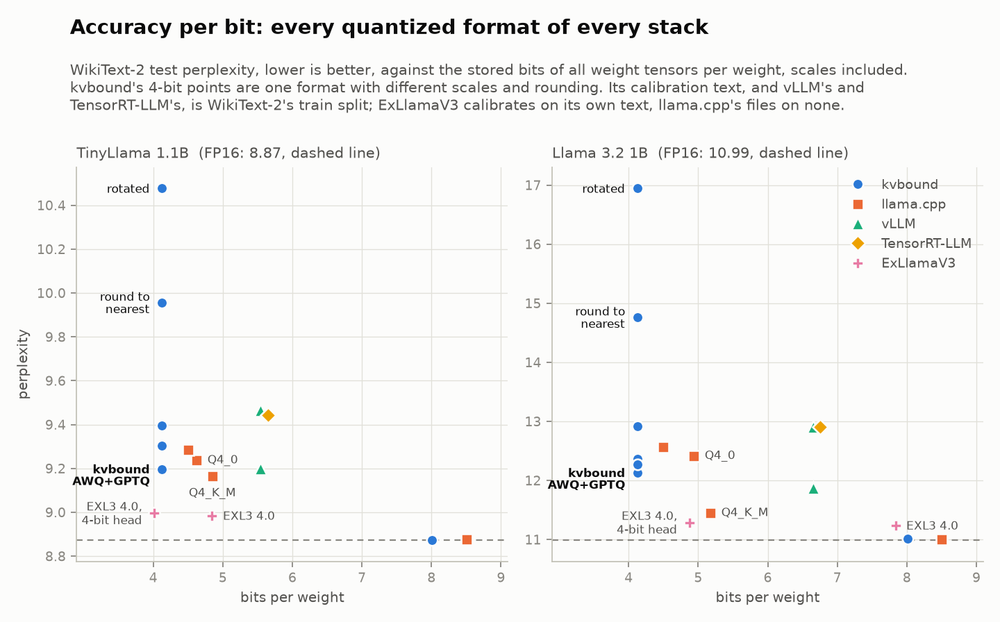
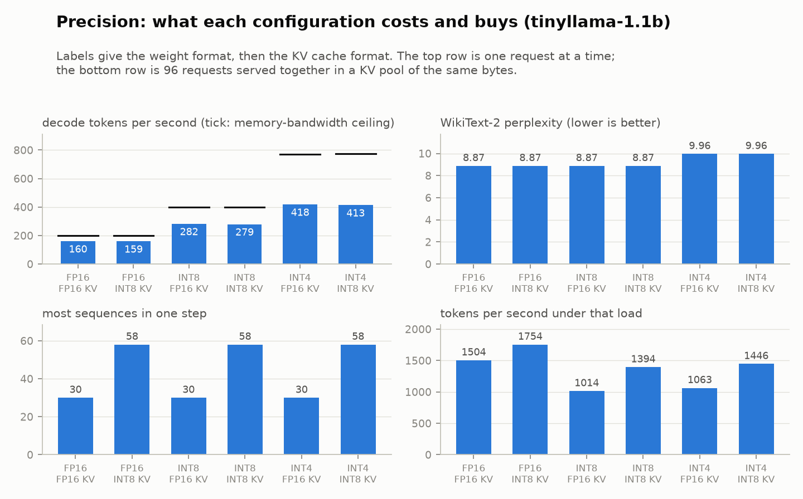

# Quantization

## Question

Decode at batch 1 is bounded by the bytes of weights read per token ([`methodology.md`](methodology.md)), and the
number of sequences a KV pool holds by the bytes per cached token. This document measures what fewer bits cost in
accuracy and what they buy in decode speed and concurrency, on TinyLlama 1.1B and Llama 3.2 1B on the RTX 3060 Ti.

## Formats

Weights are quantized symmetrically with FP16 scales, each scale rounded to FP16 before its integers are computed, so
a stored pair reproduces exactly the values the engine multiplies by
([`quantize.py`](../python/kvbound/quantize.py), [`weight_format.py`](../python/kvbound/weight_format.py)).

| Scheme | Layout | Bits per weight | TinyLlama on device |
| --- | --- | --- | --- |
| FP16 | as in the source checkpoint | 16 | 2,098 MiB |
| `int8_pc` | INT8 in [-127, 127], one FP16 scale per output channel | 8.01 | 1,050 MiB |
| `int4_g` | INT4 in [-7, 7], one FP16 scale per group of 128 along the input dimension, two values to a byte | 4.13 | 541 MiB |

Every matrix is quantized, the embedding and the vocabulary matrix included; norm gains stay FP16. The scheme is
written into the safetensors metadata, and the C++ loader and the reference model read the same file, the reference
by dequantizing it. AWQ, GPTQ and rotation mark the header (`act_scales`, `rounding`, `rotation`) but produce ordinary
`int4_g` files: the engine and its kernels are the same for every variant.

The engine multiplies packed weights by FP16 activations without expanding them in memory. Steps of up to 3 rows use
a GEMV over the packed weights; wider steps use a W8A16/W4A16 `mma.sync` product that expands weights in registers and
reads each matrix once at its packed size.

The KV cache can hold INT8 (`--kv int8`). Each stored vector, one token's key or value for one head, is 64 signed
bytes plus one FP16 scale, its largest magnitude over 127, chosen when the vector is written. Attention multiplies
each score by its key's scale and each softmax weight by its value's scale. A TinyLlama token costs 11,616 bytes
instead of 22,528, and the 176 MiB pool holds 992 blocks of 16 tokens instead of 512.

## Methods

- **Round to nearest** (`int4_g`, `int8_pc`). Each weight goes to the nearest level of its group's or row's grid.
  The ablation `int4_g.mse` instead chooses each group's clip range by its weight error.
- **AWQ** (Lin et al., 2023; `--awq`, [`awq.py`](../python/kvbound/awq.py)). A weight's error reaches the output
  multiplied by the activation it meets, so AWQ scales the input channels of a matrix before rounding, giving channels
  with large activations a finer step, and divides the activations by the same scales. Each layer has three scales:
  one for the inputs of q, k and v, folded into the RMSNorm before them; one for gate and up, folded into theirs; one
  for down_proj's input, folded into the rows of up_proj. A scale is the mean activation magnitude of its channel
  raised to the power, of 20 tried, that least changes the output of the attention or MLP it feeds. o_proj, the
  embedding and the vocabulary matrix are not scaled. Each group of 128 weights in v, o_proj, gate, up and down_proj
  then gets the clip range, of 10 tried, that changes that matrix's output least on a sample of the calibration
  activations. `int4_g.awq-noclip` is the scales without the clip search.
- **GPTQ** (Frantar et al., 2022; `--gptq`, [`gptq.py`](../python/kvbound/gptq.py), whose header derives the update).
  The solver rounds a matrix one input column at a time and, after each column, moves the columns not yet rounded so
  that they cancel as much of its output error as the calibration activations allow. Calibration runs layer by layer
  through the layers already quantized, so each matrix is fitted to the inputs it will see. Group scales are fixed
  before the solver runs: min-max, or AWQ's clip scales when both methods are used (`int4_g.awq-gptq`). Columns go by
  decreasing activation energy. The order matters on Llama 3.2: one input channel of layer 1's down_proj carries
  99.9% of that energy, all of it from the first token of each window. Rounded in input order, the solver spends the
  other tokens' accuracy on that channel, and that one matrix put into the FP16 model scores perplexity 178, where
  rounding it to nearest scores 11.8.
- **Rotation** (QuaRot's first rotation, Ashkboos et al., 2024; `--rotate`,
  [`rotate.py`](../python/kvbound/rotate.py)). The residual stream is multiplied by a seeded randomized Hadamard
  matrix folded into the weights, so that no channel stands out in any group. The rotated FP16 model (`fp16.rot`)
  computes the same function. On Llama 3.2 the rotation unties the vocabulary matrix from the embedding and stores
  263M more weights. AWQ's scales live in the norm gains, which the rotation folds away, so the two do not compose.

**Calibration.** AWQ and GPTQ use the same 128 windows of 512 tokens from the WikiText-2 train split, at the pinned
dataset revision of the test split on which perplexity is measured.

## Results

WikiText-2 perplexity (protocol in [`methodology.md`](methodology.md#metrics)), FP16 KV cache, from the engine's
logits. Every `int4_g` variant is 4.13 bits per weight.

| Weights | TinyLlama 1.1B | Llama 3.2 1B |
| --- | --- | --- |
| FP16 | 8.87 | 10.99 |
| INT8 (`int8_pc`) | 8.87 | 11.01 |
| INT4, round to nearest (`int4_g`) | 9.96 | 14.76 |
| INT4, clip chosen by weight error (`int4_g.mse`) | 10.84 | 14.63 |
| INT4, AWQ scales without the clip search (`int4_g.awq-noclip`) | 9.60 | 13.47 |
| INT4, AWQ scales and clip (`int4_g.awq`) | 9.40 | 12.91 |
| INT4, GPTQ rounding (`int4_g.gptq`) | 9.31 | 12.37 |
| INT4, AWQ scales and clip, GPTQ rounding (`int4_g.awq-gptq`) | 9.20 | 12.13 |
| FP16, residual stream rotated (`fp16.rot`) | 8.87 | 10.99 |
| INT4 of the rotated model, round to nearest (`int4_g.rot`) | 10.48 | 16.95 |
| INT4 of the rotated model, GPTQ rounding (`int4_g.rot-gptq`) | 9.30 | 12.27 |

The RTX 4070 reproduces the FP16 and `int4_g` values of both models to within 0.0001.

The figure places these checkpoints among the formats of llama.cpp, vLLM, TensorRT-LLM and ExLlamaV3, scored under
the same protocol ([`production-comparison.md`](production-comparison.md)).

Speed and concurrency, TinyLlama 1.1B. Decode is batch 1 by the median step; the last two columns serve 96 `fixed`
requests at once in a KV pool of the same bytes.

| Weights, KV cache | Perplexity | KV bytes per token | Decode tokens/s | Of its ceiling | Sequences at once | Tokens/s under load |
| --- | --- | --- | --- | --- | --- | --- |
| FP16, FP16 | 8.87 | 22,528 | 176 | 88% | 30 | 1746 |
| FP16, INT8 | 8.87 | 11,616 | 177 | 88% | 58 | 2168 |
| INT8, FP16 | 8.87 | 22,528 | 314 | 79% | 30 | 2270 |
| INT8, INT8 | 8.87 | 11,616 | 313 | 78% | 58 | 2370 |
| INT4, FP16 | 9.96 | 22,528 | 507 | 66% | 30 | 2356 |
| INT4, INT8 | 9.96 | 11,616 | 499 | 65% | 58 | 2440 |

Llama 3.2 1B decodes at 154 / 283 / 474 tokens/s with FP16 / INT8 / INT4 weights and runs 30 / 58 sequences at once
with an FP16 / INT8 cache. How the integers are chosen does not change speed: in the production-comparison records
TinyLlama decodes at 512 tokens/s with `int4_g.awq-gptq` against 510 with `int4_g`, and serves 96 requests at 2,343
against 2,334 tokens/s.

The figure plots the newest record of each configuration by the mean step. Its FP16-cache decode and serving bars
therefore come from the ablation-pair records (177, 313 and 503 tokens/s; 1804, 2214 and 2290 tokens/s under load),
and its INT8-cache bars from the table's records, whose decode reads 177, 314 and 496 tokens/s by the mean step. The
table keeps to the `make precision` records ([provenance](methodology.md#measurement-protocol-and-provenance)).

## Analysis

- **Decode follows the bytes.** A decode step is the weights crossing the memory bus once plus about 0.7 ms of
  everything else, at every weight precision. The floor set by the weights is 5.0, 2.5 and 1.3 ms for FP16, INT8 and
  INT4, and the measured step 5.7, 3.2 and 2.0 ms. The share of the ceiling falls because the remainder does not
  shrink with the weights; on Llama 3.2, with 16 layers against 22, the step ends 0.5 to 0.6 ms above its floor.
- **INT8 weights are free in accuracy; INT4 is not.** Round-to-nearest INT4 raises perplexity by 12% on TinyLlama and
  34% on Llama 3.2.
- **Calibration recovers most of the INT4 gap.** AWQ recovers 52% of the gap between INT4 and FP16 on TinyLlama and
  49% on Llama 3.2; the scales alone recover 33% and 34%, the clip search the rest. Clipping by weight error alone
  makes TinyLlama worse and barely moves Llama 3.2: the clip has to be chosen by its effect on the output. GPTQ alone
  recovers 60% and 63%. On top of AWQ's scales it recovers 70% on both, which leaves INT4 4% above FP16 on TinyLlama
  and 10% on Llama 3.2.
- **Against other formats.** AWQ in vLLM and TensorRT-LLM, on the same calibration windows, scores within 0.07 of
  kvbound's. llama.cpp's Q4_0, with one scale per 32 weights, rounds to nearest better than `int4_g` (9.29 against
  9.96 on TinyLlama with every matrix quantized), and kvbound's AWQ and GPTQ checkpoint scores better than both Q4_0
  files on both models at fewer bits. Q4_K_M, at 4.85 and 5.18 bits per weight, scores better on both models, by
  0.03 on TinyLlama and 0.69 on Llama 3.2 (11.44 against 12.13). ExLlamaV3's trellis-coded format is 0.12 above
  FP16 on TinyLlama at 4.02 bits, where kvbound's best checkpoint is 0.32 above at 4.13.
- **An INT8 cache buys concurrency, not decode speed.** The pool holds 58 sequences instead of 30. With FP16 weights
  that is 24% more tokens/s under load, and each token takes longer to arrive: the median time per output token is
  19.2 ms against 12.9. With INT8 or INT4 weights the INT8-cache runs read 4.4% and 3.6% higher, and all four of those
  runs are tagged `clock_varied`, so the records show no measurable difference. Batch-1 decode does not change (176
  and 177 tokens/s with FP16 weights): attention over an INT8 cache is 10% faster at batch 8, but attention is a few
  percent of a step and is not bound by bandwidth.
- **Under load, quantized weights are faster than FP16**: 2270 and 2356 tokens/s with INT8 and INT4 weights against
  1746, 30% and 35% more, because steps wider than 3 rows multiply the packed weights on tensor cores. In the
  ablation with the tensor-core quantized path and the other kernel options disabled
  (`--no-fuse --f16-gemv-rows 0 --no-prefill-attention --expand-quantized`), wide steps expand each quantized matrix
  to FP16 for cuBLAS, and the same workload runs at 979 and 1,013 tokens/s against 1,463 in FP16. Over the ablation
  pairs of both models, quantized weights serve 20% to 27% faster than FP16 on the RTX 3060 Ti and 28% to 54% on the
  RTX 4070 with every option on, and 30% to 40% and 15% to 31% slower with those four options off.
- **Rotating the residual stream does not help this format.** Rounded to nearest, the rotated model is worse than
  the unrotated one on both checkpoints (10.48 against 9.96, 16.95 against 14.76); with GPTQ it changes little (9.30
  against 9.31, 12.27 against 12.37) and on Llama 3.2 costs a fifth more stored weights. Two diagnostic runs on
  Llama 3.2, not recorded, rule out the explanations tried. Swapping only the down_proj matrices into the FP16 model
  costs less perplexity rotated than unrotated (11.44 against 11.55), so the matrix with the massive activation is
  not where rotation loses. Leaving each window's first token out of GPTQ's calibration, to keep that activation from
  dominating, takes perplexity to 131 unrotated and 143 rotated. ExLlamaV3's format also rotates, but each matrix and
  with trellis coding instead of scalar groups of 128, so its result does not test this one.

## Limitations

- **Calibration is in-domain.** AWQ and GPTQ calibrate on the WikiText-2 train split and are scored on its test
  split; the checkpoints are not scored on text from another source, and llama.cpp's files, quantized without data,
  are not compared with an importance matrix (`llama-imatrix`). The calibrated rows may overstate what text from
  elsewhere gains.
- **No format between 4.13 and 8 bits**, where Q4_K_M and, on Llama 3.2, vLLM's GPTQ file score better.
- **Perplexity is the only accuracy metric** for the Llama models. For Whisper, INT4 weights raise the word error rate
  ([`whisper.md`](whisper.md)).
- **Weight-only quantization.** Activations stay FP16; no FP8 path exists for weights or the KV cache.
- **INT4 decode stops at 66% of its ceiling** on the RTX 3060 Ti because the 0.7 ms remainder of a step does not
  shrink with the weights ([`kernel-optimization.md`](kernel-optimization.md)).
- **Why rotation does not help is not established**, and the two diagnostics behind that conclusion are not records.
- **Unlocked clocks.** All records come from Windows; comparisons smaller than the clock variation, such as the INT8
  cache with quantized weights, are not resolved.
