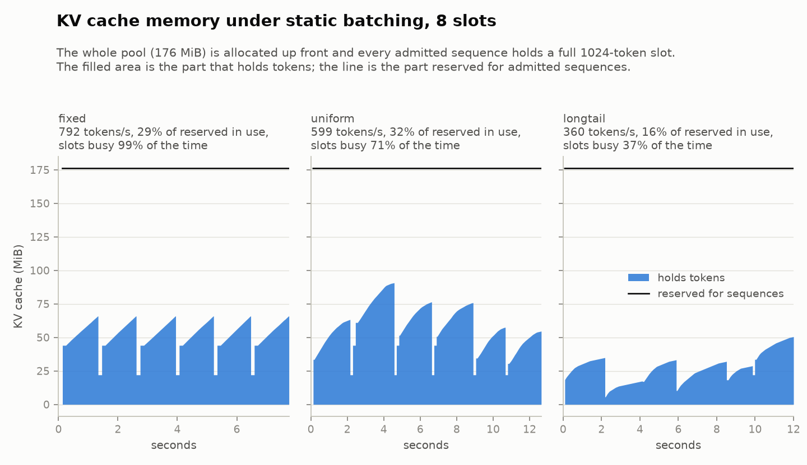
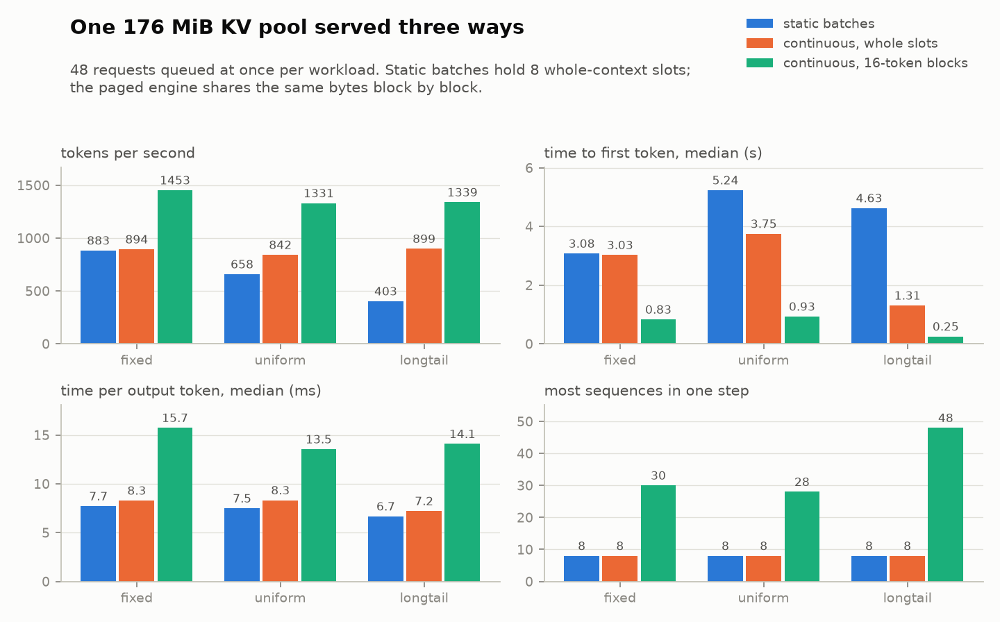
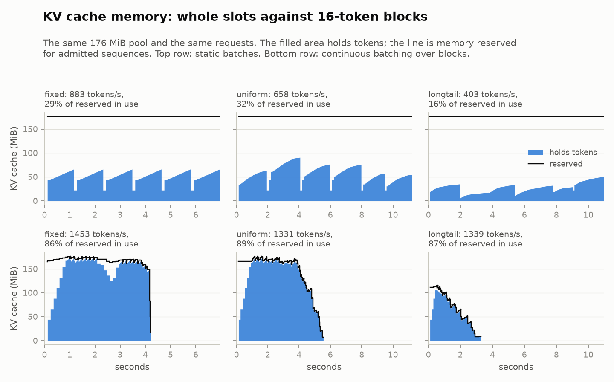
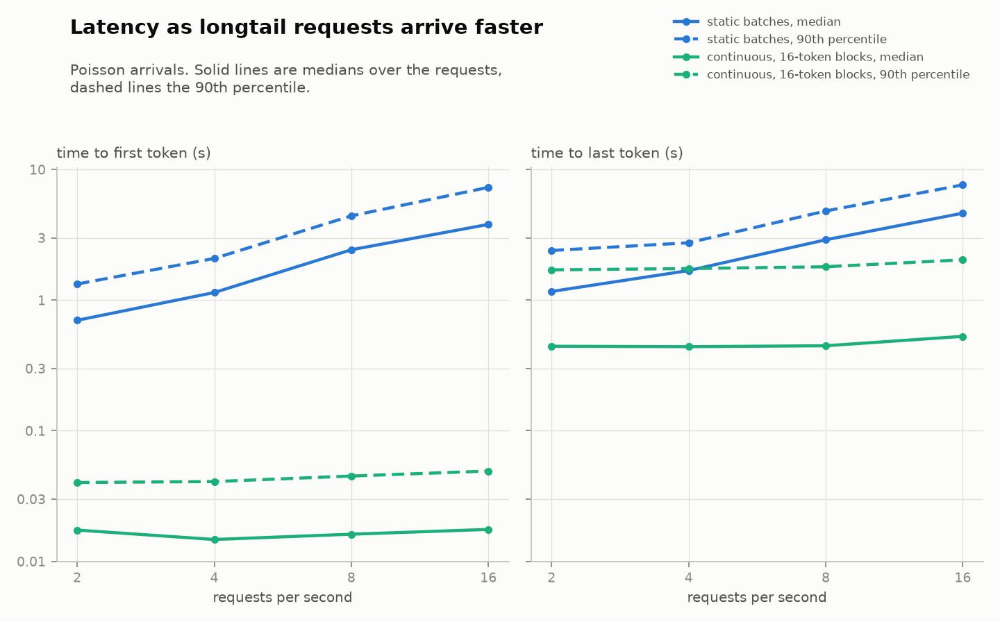

# Static and paged KV memory

Every token a transformer has processed leaves a key and a value vector in each layer, and every later token's
attention reads all of them. That store, the KV cache, is the one piece of memory in an inference engine that grows
while a request runs and whose final size is unknown until the request ends. kvbound has two designs for it, built
on the same pool of GPU memory and the same kernels:

- **Static.** The pool is cut into a fixed number of *slots*, each large enough for the longest sequence the engine
  accepts (1,024 tokens here). An admitted request owns a whole slot. A batch runs until its longest member finishes,
  and only then does the next batch start.
- **Paged.** The same pool is cut into *blocks* of 16 tokens. A sequence holds a list of blocks, its *block table*,
  gets another block only when it grows into one, and returns its blocks the moment it ends. Requests join and leave
  between any two steps of the engine (*continuous batching*), up to 64 at a time.

On an RTX 3060 Ti with TinyLlama 1.1B and a 176 MiB pool, the static design runs 955 tokens/s on requests of equal
length and 451 on a long-tailed mix; the paged design runs 1776 and 1469 tokens/s in the same memory. With static
slots most of the reserved memory holds nothing; with blocks 89% to 92% of it holds tokens. The price is a longer
wait between a request's tokens, work thrown away when the pool runs out, an indirection in every read of the cache,
and more code. A static design is still the right one where a single sequence runs at a time, where a cache's size is
known exactly, and where a compiler needs every shape fixed ahead of time, as on a phone's NPU.

> **Data.** RTX 3060 Ti (8 GB), Windows, unlocked clocks, driver 576.02. Serving, arrival and precision records are
> of 2026-11-17 at commit `c442759` (`make serve`, `make serve-load`, `make precision`), under
> `results/raw/rtx3060ti-fd7b40d5/`. The 64-graph comparison is from an earlier engine build, commit `b724c45`
> (2026-11-13). The Snapdragon profiles are of 2026-11-19, under `results/profiles/`.

## Terms

| Term | Meaning here |
| --- | --- |
| Pool | One allocation of GPU memory, made when the engine starts, that holds every cached key and value. Its size never changes. |
| Slot | Room for one sequence of the maximum context length (`max_ctx`) in the static design. |
| Block | A fixed number of consecutive positions of one sequence (`kv_block_size`), the unit the paged design hands out. |
| Block table | Per running sequence, the list of physical blocks that hold its positions, in order. |
| Admission | Taking a waiting request into the running set, which gives it cache memory. |
| Preemption | Taking a running sequence's memory away; kvbound then recomputes it from its first token. |
| Step | One forward pass of the model over a set of rows; each row is one token of one sequence. |
| TTFT, TPOT | Time to first token (from arrival); time per output token after the first. |

## The pool both designs share

The pool is [`KvPool`](../engine/include/kvbound/cuda/kv_pool.h): one buffer of keys, one of values, an FP16 scale per
stored vector when the cache is INT8, and a block table of `max_seqs` rows. In the default layout (`head_major` in
[`kv_layout.h`](../engine/include/kvbound/kv_layout.h)) keys are stored as `K[layer][block][kv_head][pos][dim]`, so
one head's positions within a block are adjacent and each key's 64 dimensions are one 128-byte run. A cached token
costs 22,528 bytes across TinyLlama's 22 layers in FP16.

Of three orderings benchmarked with the engine's kernels ([`kv_layout.png`](../reports/rtx3060ti/kv_layout.png)), the
two that keep a key's dimensions adjacent differ by 2% in attention time at batch 1 and 11% at batch 8. What matters
more is how many memory requests a warp issues: reading each 128-byte key as eight 16-byte loads instead of 64
two-byte loads is 2.9 times faster (3.4 at batch 8), and only those two layouts allow it. Nsight Compute counters
(`make counters`) match the counts derived from the code: for one layer at batch 1 with 4,096 cached tokens, the
2-byte kernel asks the L1 cache for 8.9 million sectors and the 16-byte kernel for 1.6 million, while both read the
same 4.2 MB from DRAM, the layer's keys and values exactly once. Attention moves roughly 17 to 50 GB/s, far below the
memory bandwidth, so the wide loads help by cutting L1 traffic, not DRAM traffic.

The two designs differ only in two numbers handed to the pool: the block size, and how many blocks a sequence may
hold. The static design is the paged code with one block per sequence whose size is the whole context:

```text
Static: 8 blocks of 1,024 positions             Paged: 512 blocks of 16 positions
block table: 8 rows x 1 entry                   block table: 64 rows x 64 entries (1,024 / 16)

 row 0 -> [ 3 ]   block 3: seq A, pos 0..1023    row 0 (seq A) -> [ 7 | 2 | 9 | - ...]
 row 1 -> [ 0 ]   block 0: seq B, pos 0..1023    row 1 (seq B) -> [ 4 | 0 | - ...]
 ...              (a 300-token sequence leaves   ...
                   724 positions of its block    block 7: A pos 0..15    block 4: B pos 0..15
                   empty until its batch ends)   block 2: A pos 16..31   block 0: B pos 16..31
                                                 block 9: A pos 32..47   other blocks: free, or
                                                                         other sequences
 position p of a sequence is in                  position p of sequence A is in
   block row[0], offset p                          block row_A[p >> 4], offset p & 15
```

The pool knows nothing about which blocks are in use. All bookkeeping runs on the CPU: a
[`BlockAllocator`](../engine/include/kvbound/block_allocator.h) hands out block ids from a free list, a second one
hands out block-table rows, and the [`Scheduler`](../engine/include/kvbound/scheduler.h) decides who gets what. The
device only sees block-table rows, which `KvPool::set_blocks` copies from a pinned host mirror whenever a sequence's
list changes.

## Static design

`python -m kvbound.serve --policy static --slots 8` (the default block size is `max_ctx`). When no batch is running,
the next 8 waiting requests form one, and each gets its slot at admission for its whole life (`Scheduler::plan_static`
in [`scheduler.cpp`](../engine/sched/scheduler.cpp)). Slots return only when every member of the batch has finished;
a slot whose request ends early sits idle and reserved. A running sequence cannot run out of memory, so nothing is
preempted, and once the prompts are processed a step's row count changes only when batch members finish.

## Paged design

`python -m kvbound.serve --policy continuous --kv-block-size 16 --slots 64`, which is what `make serve` measures.

**Finding a position.** Position `p` of a sequence lives in physical block `block_table[row * 64 + p / 16]` at offset
`p % 16` (`KvView` in [`kv_layout.h`](../engine/include/kvbound/kv_layout.h)). The host computes each new token's
destination once, `kv_slot = block * 16 + p % 16`, when it lays out a step's rows (`build_step_rows` in
[`sequence.cpp`](../engine/runtime/sequence.cpp)); the fused RoPE and cache-write kernel
([`rope_kv_write.cu`](../engine/kernels/rope_kv_write.cu)) stores k and v straight into that slot. Attention resolves
the block for every element it reads (`SeqKv::offset` in [`attention.cu`](../engine/kernels/attention.cu)) by loading
the block id from the sequence's row and splitting the position with a shift and a mask; with one block per sequence
it reads the block id once and skips the lookup. The decode kernel loops over positions `0..p` of each query; the
tensor-core prefill kernel walks the same table in tiles of 64 positions.

**The block size must be a power of two.** Splitting the position with a division makes attention 1.37 to 1.84 times
slower than one block per sequence; a shift and a mask bring it to 1.07 to 1.12 times (`python -m kvbound.microbench
kv_layout`), so `KvPool` refuses other block sizes when a sequence spans several blocks. Whether a sequence's blocks
are in order or scattered over the pool makes no difference.

**Admission.** Waiting requests are admitted first come, first served, while a block-table row is free and the free
blocks cover the request's prompt plus one spare block for every running sequence that can still grow, and one for
the newcomer if it can (`Scheduler::plan_continuous`). The spares let each running sequence decode at least 16 more
tokens before anything gives way. An empty pool admits the first request unconditionally. Admission is deliberately
optimistic: a request's `max_new_tokens` is known, but its blocks are not reserved.

**Growth and preemption.** Before each step, every sequence about to write the first position of a new block gets
one, oldest first. If none is free, the most recently admitted sequences are preempted until one is: their blocks and
row return to the pool, and they go back to the front of the queue with their prompt and everything generated so far,
which runs again as a prompt when they are readmitted. The oldest running sequence is never preempted, so the queue
always drains, and a step that had to preempt admits nobody. Evicted blocks are recomputed, not copied to host memory.

**Composing a step.** Every decoding sequence gets one row; sequences still in their prompt share the rest of the
step's `max_step_tokens` rows (1,024) in admission order, so a long prompt is split over several steps. Decode-shaped
steps replay a captured CUDA graph, one per row count. Continuous batching changes the row count whenever a sequence
joins or leaves, so the engine keeps the 16 most recently used graphs (`max_graphs` in
[`engine.h`](../engine/include/kvbound/cuda/engine.h)) and captures a new one when a row count is missing.

**Sharing blocks.** Each block carries a reference count ([`block_allocator.cpp`](../engine/kv/block_allocator.cpp)).
`fork_blocks` gives a child its parent's blocks for the first `n` tokens. Before a write, `prepare_write` appends a
fresh block if the list ends there, or, if the block has other references, allocates a copy that `KvPool::copy_block`
queues ahead of the step. A parent with `c` children costs `c - 1` block copies, and none when the next position opens
a new block. Only the speech engine's beam search forks sequences
([`asr_engine.cpp`](../engine/runtime/asr_engine.cpp)); the Llama serving path never shares blocks.

## The INT8 KV cache

With `--kv int8` each stored vector, one token's key or value for one head, is 64 signed bytes plus one FP16 scale,
its largest magnitude over 127, chosen by the write kernel. Attention multiplies each score by its key's scale and
each softmax weight by its value's scale, so the integers are never expanded in memory. A token costs 11,616 bytes
instead of 22,528, and the 176 MiB pool holds 992 blocks instead of 512.

## Measurements

The pool is 176 MiB for TinyLlama (8 sequences of 1,024 FP16 tokens) and 256 MiB for Llama 3.2 1B, the same bytes
under every policy. Each workload is 48 requests queued at once: `fixed` (256-token prompts, 128-token outputs),
`uniform` (prompts 32 to 512, outputs 16 to 256) and `longtail` (lognormal, median prompt 64 and output 48).
Workloads and metrics, including "reserved KV holding tokens", are defined in [methodology.md](methodology.md).

### What static slots waste

| TinyLlama, 8 static slots | Tokens/s | Reserved KV holding tokens | Slots busy |
| --- | --- | --- | --- |
| `fixed` | 955 | 30% | 99% |
| `uniform` | 723 | 33% | 71% |
| `longtail` | 451 | 15% | 38% |



One request at a time runs at 173 to 175 tokens/s on the same workloads. Two losses show. Even on `fixed`, where
every slot is busy 99% of the time, a 384-token request in a 1,024-token slot leaves most of it empty: the reservation
is sized for the longest request the engine accepts. On `longtail` one long request keeps a whole batch alive while
the other seven slots sit finished but reserved, so slots are busy 38% of the time.

### Separating the scheduler from the paging

The middle row of each workload runs continuous batching over the same 8 whole slots: a finished request's slot is
reused at the next step, but each request still reserves 1,024 positions.

| Workload | Setup | Tokens/s | Most sequences in a step | TTFT median | TPOT median | Reserved KV holding tokens |
| --- | --- | --- | --- | --- | --- | --- |
| `fixed` | static batches, 8 slots | 955 | 8 | 2.79 s | 7.5 ms | 30% |
| `fixed` | continuous, 8 whole slots | 966 | 8 | 2.75 s | 7.9 ms | 31% |
| `fixed` | continuous, 16-token blocks | 1776 | 30 | 0.51 s | 13.0 ms | 89% |
| `uniform` | static batches, 8 slots | 723 | 8 | 4.70 s | 7.3 ms | 33% |
| `uniform` | continuous, 8 whole slots | 874 | 8 | 3.75 s | 8.2 ms | 33% |
| `uniform` | continuous, 16-token blocks | 1593 | 28 | 0.51 s | 11.7 ms | 92% |
| `longtail` | static batches, 8 slots | 451 | 8 | 4.15 s | 6.5 ms | 15% |
| `longtail` | continuous, 8 whole slots | 947 | 8 | 1.25 s | 7.1 ms | 19% |
| `longtail` | continuous, 16-token blocks | 1469 | 48 | 0.18 s | 12.0 ms | 89% |





- **The scheduler alone** fixes the idle-slot loss and nothing else: 451 to 947 tokens/s on `longtail`, little
  change on `fixed`, where no slot idles (955 to 966).
- **Paging** fixes the oversized reservation. Each sequence holds only the blocks its tokens fill, so the same bytes
  hold 30, 28 and 48 sequences instead of 8, and requests wait far less for their first token.
- **The pool is not the limit on `longtail`.** All 48 requests run at once and on average only 38% of the pool is
  reserved, against 95% on `fixed` and 81% on `uniform` (`kv_reserved_of_pool` in records `…203144Z-serve-efb9`,
  `…202354Z-serve-25c2`, `…202836Z-serve-37c3`). Every static run reserves 100% of the pool throughout
  (`…202306Z-serve-a9cd`, `…202735Z-serve-2915`, `…203105Z-serve-05cc`).

On Llama 3.2 1B (16 layers, 8 KV heads) in a 256 MiB pool:

| Llama 3.2 1B, `fixed` / `uniform` / `longtail` | Tokens/s | Most sequences in a step |
| --- | --- | --- |
| Static batches, 8 slots | 883 / 658 / 397 | 8 |
| Paged, continuous batching | 1877 / 1628 / 1397 | 30 / 28 / 48 |

### Arriving requests

With `longtail` requests arriving as a Poisson process at 8 per second, the median time to first token is 1.9 s with
static batching and 13 ms with paging; at 16 per second, 3.3 s and 15 ms (`make serve-load`). A static batch makes a
new arrival wait for the slowest member of the batch ahead of it.



### The INT8 cache in the paged pool

96 `fixed` requests, TinyLlama with FP16 weights, the same pool bytes:

| KV cache | Bytes per token | Blocks in the pool | Sequences at once | Tokens/s under load | Batch-1 decode |
| --- | --- | --- | --- | --- | --- |
| FP16 | 22,528 | 512 | 30 | 1746 | 176 tokens/s |
| INT8 | 11,616 | 992 | 58 | 2168 | 177 tokens/s |

Perplexity is 8.87 with either cache. Halving the bytes per token nearly doubles the sequences and gives 24% more
tokens/s; the median time per output token rises from 12.9 to 19.2 ms, since each step carries more rows. Batch-1
decode does not change, because one sequence never fills the pool. With INT8 or INT4 weights the INT8 cache makes no
measurable difference in these records.

## What paging costs

| Cost | What the records show |
| --- | --- |
| Slower tokens per request | Median TPOT on `fixed` rises from 7.5 ms (static) to 13.0 ms (paged), and 7.9 ms with continuous batching over 8 whole slots: the paged run carries up to 30 sequences per step instead of 8, which is what the freed memory is spent on. |
| Recomputed work | Optimistic admission overfills the pool: 9 preemptions and 2,769 tokens processed twice per pass on `fixed`, 5 and 1,684 on `uniform`, none on `longtail`, whose 48 requests all fit at once. |
| Indirection in attention | A block-table lookup per element read makes attention 1.07 to 1.12 times slower than one block per sequence, and only with a power-of-two block size. |
| CUDA graphs | On `longtail`, 41 graph captures and 55 ms of capture per pass, with 99% of steps still replayed (`graphs_captured`). The static runs capture none during their measured passes. On an earlier engine build, room for 64 graphs removed the captures on `longtail` and gave 1386 tokens/s against 1339 with 16; this was not repeated on the engine measured here. |
| Leftover fragmentation | 89% to 92% of reserved positions hold a token. The rest are the unfilled end of each sequence's last block and prompt positions not yet processed. Any free block serves any sequence, so free memory never needs to be contiguous. |
| Complexity | A block allocator, a block table copied to the device on every allocation, an admission rule, preemption and recomputation, and a graph cache keyed by row count. Static batching needs none of these. |

In an FP16 TinyLlama decode step attention is 5% of kernel time and streaming the weights through the matrix products
90% (Nsight Compute counters of one step), so the lookup acts on a small share of the step. Its end-to-end cost on a
decode step is not measured separately.

## Where a static design is still right

**One sequence at a time.** The slot loss comes from sequences that end or start at different times and from
reservations sized for a longer request than the one running. A single user on a single device has no other sequence
to give freed memory to. One sequence runs at 173 to 175 tokens/s under the static policy; a block table would add
the lookup and buy nothing. Paged serving at batch 1 has no record of its own.

**Caches whose size is known.** The speech engine ([whisper.md](whisper.md)) keeps two caches. The decoder's keys and
values grow with the transcript and use 16-token blocks. The cross-attention cache, the encoder's keys and values, is
always exactly 1,500 positions and never written after the encoder step, so it is one static block per sequence
(`cross_` in [`asr_engine.cpp`](../engine/runtime/asr_engine.cpp)), shared by the beams of one clip by reference
count.

**Activations.** The fused forward pass has 203 intermediate tensors. Side by side they would need 1,369 MiB for
1,024-token steps; placed by lifetime in one arena they share 37 MiB, which is also the lower bound
([`arena.png`](../reports/rtx3060ti/arena.png)).

**Accelerators that compile fixed shapes.** NPU compilers schedule a graph whose every tensor shape is known when it
is compiled. A block table, a data-dependent gather, and a step whose row count and context length change from one
call to the next do not fit that model.

## A production static design: Llama 3.2 1B on a Snapdragon NPU

Qualcomm's stock export of Llama 3.2 1B Instruct (W4A16, `qai-hub-models export llama_v3_2_1b_instruct`) is profiled
on the Hexagon NPU of a Galaxy S25 and a Galaxy S26 through Qualcomm AI Hub
([`qai_hub.py`](../python/kvbound/baselines/qai_hub.py); summaries under `results/profiles/*-qaihub-*`).

| | kvbound, paged (RTX 3060 Ti) | Qualcomm export (Snapdragon NPU) |
| --- | --- | --- |
| Memory fixed at start | The pool, sized when the engine starts | A context of 4,096 positions, compiled into every graph |
| Step shapes | Any number of rows up to 1,024; a CUDA graph per row count | Two: 128 tokens per pass for prompts, 1 token for generation. A shorter prompt is left-padded and masked; a longer one runs in 128-token passes. |
| Context a step attends over | Positions `0..p` of each sequence: the loop stops at the current position | All 4,096 positions every step, with an additive mask over those not yet written |
| Writing new keys and values | In place: the fused RoPE and cache-write kernel stores them in their block | Keys and values enter each graph as per-layer inputs (keys stored transposed); only the new entries come out, and the host runtime copies them into its buffers |
| KV quantization | Optional INT8, one FP16 scale per vector, chosen when it is written | 8-bit, one fixed scale per layer for keys and one for values, from calibration |
| Sequences per step | Up to 64 | 1 |

From the per-graph latencies, decode works out to 58.2 tokens/s on the S25 (17.174 ms per token) and 59.9 on the S26
(16.693 ms), and a 128-token prompt pass to 31 and 27 ms (`derived` in the summaries). These are graph latencies only:
the runtime's work between the model's three parts and between steps, writing new KV entries into the cache buffers,
the mask and RoPE inputs prepared on the host, sampling and detokenization are left out. A phone NPU running one
sequence and a desktop card with a 220 W power limit are not a comparison of engines; what carries over is the design.

Because every step covers the full context, attention costs the same at position 10 as at position 4,000. In the
prompt graphs of the two transformer parts, `softmax` over the 4,096 positions is the costliest operator type (36% and
30% of cycles on the S25, 32% and 27% on the S26). In the token graphs the costliest is `matmul`, attention's products
in this export (38% and 33% on the S25, 51% and 45% on the S26). These are shares of cycles counted over parallel
units, not of latency. kvbound's decode step is the opposite: weights streaming through the matrix products take 90%
of an FP16 TinyLlama step and attention 5%, and attention grows with the real length: at batch 1 a 1,100-token context
costs about 0.3 ms more per step than a 190-token one.

Both designs fix their memory before the first request. What follows the sequence's real length is, in kvbound, the
work of every step; in the NPU export, only the number of 128-token prompt passes, while every step costs as much as a
full context. That is the price of the fully static shapes its compiler needs.

## What was not built or measured

- **Prefix sharing for text requests.** Reference counts and copy-on-write serve beam search in the speech engine;
  requests with a common prompt prefix do not share blocks.
- **Static reservations sized to the request.** The static policy over 16-token blocks would reserve exactly
  `prompt + max_new_tokens`, separating "reserve by request length" from "allocate on demand".
- **The static design with an INT8 cache**, and block sizes other than 16 in serving.
- **The cost of copy-on-write.** The speech records do not count block copies per beam step.
- **Swapping preempted blocks to host memory**, and admission rules other than one spare block per growing sequence.
- **The end-to-end effect of the block-table lookup** on a decode step, beyond the attention microbenchmark, and
  room for more than 16 CUDA graphs on the engine measured here.
- **A paged design on the NPU**, or kvbound on the phone. The NPU figures are graph latencies, not end-to-end runs.
- **An FP8 KV cache.**
